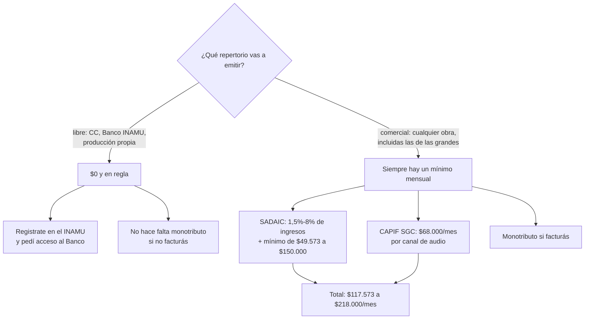

# Radio online legal en Argentina — plan, costos y plazos

**Proyecto:** `radio.daza.ar` (Icecast + Liquidsoap, dominio propio, sin YouTube)
**Fecha del relevamiento:** octubre 2026
**Números vigentes:** los montos en pesos son de **septiembre/octubre 2026** y varios se ajustan por IPC cada 6 meses.

> Este documento es un relevamiento de fuentes públicas, no asesoramiento legal.
> Antes de firmar nada, una consulta con abogado especialista en propiedad intelectual cierra las dudas abiertas de la sección 7.

---

## 1. Qué determina si pagás (y qué no)

> OJO: **Corrección.** La versión anterior de este documento afirmaba que "el criterio es que se paga cuando hay facturación o auspicio", apoyándose en un aviso del home de SADAIC. **Eso estaba mal formulado.** El aviso existe, pero dice algo más acotado y es de **mayo de 2020**.

SADAIC publica en su home, como noticia destacada, el aviso *"Para que no haya dudas en el Uso de Música en la Web"*:

> *Usted **"No debe pagar"** derechos de autor, por subir obras musicales a la web vía Youtube, Facebook o Instagram para difusión, promoción y ejecución pública **como autor, compositor o intérprete**.*
> ***"Sí deben pagar"** derechos de autor, aquellos que **soliciten un pago** a quienes deseen ver el evento musical, o quienes tengan como **auspiciantes, marcas comerciales o similares** como forma de publicidad [...]*

**Alcance real de ese aviso:** (a) **la persona música que sube sus propias obras** a redes, y (b) **eventos musicales en vivo** transmitidos con cobro de entrada o auspicio. **No dice que una radio que difunde música de terceros no pague.** Extenderlo a "radio online = gratis si no facturo" es un error.

La posición de SADAIC para radio por internet es explícita y va en el otro sentido (FAQ de SADAIC, recogida por Radios Libres):

> *Pregunta: Tengo previsto lanzar una Radio por Internet... ¿Necesito contar con algún tipo de autorización para transmitir música en las emisiones? ¿Qué arancel debo abonar?*
> *Respuesta: **Debe solicitar autorización a SADAIC.** El arancel a abonar [...] es el que se consigna en el Apartado 3 del Anexo 1 del Régimen Autoral y Licencia para el uso del repertorio de Sadaic en Internet o redes análogas vigente. El pago [...] deberá acompañarse con la respectiva **Declaración Jurada Mensual** [...]*

### El segundo error que hay que desactivar

**No facturar NO significa pagar cero.** Tanto SADAIC como CAPIF SGC fijan **mínimos mensuales** justamente para el caso de ingresos bajos o nulos. El porcentaje se calcula sobre publicidad; **el mínimo se paga igual**.

### Entonces la decisión real es esta

| | **Escenario A — música libre** | **Escenario B — música comercial** |
|---|---|---|
| Repertorio | CC - Banco INAMU - propia | Cualquier obra, incluidas las comerciales |
| Licencias de derechos | **Ninguna hace falta** | SADAIC + CAPIF SGC (**siempre**, aun sin ingresos) |
| Costo de derechos | **$0** | 10% de publicidad + mínimo SADAIC - mínimos CAPIF SGC |
| Monotributo | No hace falta si no facturás | Obligatorio si facturás |
| **Total mensual estimado** | **$0** | **~$150.000 – $500.000+** |

> **La regla correcta: no se paga según cuánto facturás, se paga según qué repertorio usás.**
> Repertorio libre -> $0 y en regla. Repertorio comercial -> siempre al menos un mínimo.

---

## 2. Lo que NO hace falta (verificado)

| Concepto | Estado |
|---|---|
| **Licencia ENACOM** | **No aplica.** La Ley 26.522 regula el espectro radioeléctrico. Una radio que sólo existe por internet no pide licencia. |
| **Registro de Servicios TIC** | No aplica. Ese registro es para prestadores de acceso a internet, no para contenido. |
| **Argentores** | No aplica (es para obras teatrales). |
| **DNDA** | Sólo si querés registrar obras de tu autoría. No es requisito para operar. |

El DNU 70/2023 además eliminó el límite de multiplicidad de licencias, pero eso sólo importa para FM/AM.

---

## 3. Costos, concepto por concepto

> **Referencia de cambio:** UVA = **$2.155,36** (BCRA, 14/10/2026). Varios aranceles se fijan en UVAs.

### 3.1 Vía gratuita

| Concepto | Costo | Fuente |
|---|---|---|
| Registro de la Actividad Musical (INAMU) | **$0** | INAMU |
| Banco de Música Nacional e Independiente (25.000+ temas) | **$0** | INAMU |
| Música libre (CC0/CC-BY, FMA, Jamendo, ccMixter, netlabels) - producción propia | **$0** | — |

### 3.2 SADAIC — obras musicales (composición / letra)

El régimen que encuadra una radio online es el **Anexo I, punto 3 "Webcasting / streaming no interactivo", inciso a) transmisión exclusivamente sonora (tipo radiodifusión sonora)** — descargable en `sadaic.org.ar/shared/cdrw/pdf-REGIMEN INTERNET DESDE 01-02-2020.pdf`:

| Uso del repertorio en el total de la transmisión | Alícuota sobre ingresos |
|---|---|
| Hasta 30% del tiempo | **2%** |
| Más de 30% y hasta 70% | **5%** |
| Más de 70% | **8%** |

Mínimo mensual por visitas (mismo anexo):

| Visitas mensuales al sitio | Mínimo |
|---|---|
| hasta 5.000 | **$550** |
| 5.001 – 10.000 | $1.100 |
| 10.001 – 50.000 | $5.380 |
| 50.001 – 100.000 | $7.160 |
| 100.001 – 150.000 | $8.910 |
| cada tramo adicional de 150.000 | +$10.700 |

> OJO: **Ese anexo tiene vigencia desde el 01/02/2020 y nunca se actualizó.** $550 de mínimo no tiene relación con los valores de 2026. Es el único régimen de webcasting que SADAIC tiene publicado, y está congelado hace seis años.

Hay además tres instrumentos posteriores que compiten con él:

| Instrumento | Alícuota | Mínimo mensual | Vigencia |
|---|---|---|---|
| **Licencia de Canales de Streaming** (live stream) | 1,5% | $50.000 - $75.000 - $100.000 - **$150.000** según horas semanales (>12 h = $150.000) | 01/07/2025 |
| **Acuerdo ARPA** (radios comerciales, uso intensivo >70%) | 1,80% alta potencia - 0,90% baja | **23 UVA ~ $49.573** (alta) - **18 UVA ~ $38.796** (baja) | Ago 2026 |
| **Inclusión en Radio** (default radiodifusoras) | — | **$768.000** | 01/09/2026 |
| Inclusión en Podcast (referencia) | — | $768.000 | 01/09/2026 |

**Lo que hay que resolver con SADAIC por escrito:** cuál de estos cuatro aplica a una radio exclusivamente online. La horquilla realista para el mínimo es **$49.573 (ARPA) -> $150.000 (live stream)**.

### 3.3 CAPIF SGC — fonogramas (grabación)

Acá sí hay un régimen preciso y vigente. Reglamento de Recaudación y Fijación de Aranceles, **texto octubre 2026**, punto 4.5 *Webcasting no interactivo*: la unidad es cada canal de audio lineal.

| Componente | Arancel por canal |
|---|---|
| Productores fonográficos | $37.000/mes |
| Artistas intérpretes | $31.000/mes |
| **Licencia integrada (ambos)** | **$68.000/mes** |

**Una radio online con un solo stream = $68.000/mes.** Cada canal adicional se multiplica.

Si además hay FM/AM con la misma programación, aplica el capítulo 3 (y por la regla de neutralidad tecnológica del punto 3.8, la difusión simultánea por internet **no** genera arancel adicional):

| Medio | Alícuota | Grandes centros / >500.000 | 50.000–500.000 | <50.000 |
|---|---|---|---|---|
| Radio FM comercial | 2,40% | $168.000 | $134.000 | $110.000 |
| Radio AM comercial | 2,00% | $90.000 | $72.000 | $54.000 |
| **Radio comunitaria** | — | **$34.000** | | |
| **Radio FM local no comercial (<50.000 hab.)** | — | **$28.000** | | |
| **Radio FM regional no comercial (>=50.000 hab.)** | — | **$45.000** | | |

- **Factor de uso** (sólo AM/FM): x1,00 si >90% música - x0,90 - x0,80 - x0,60 - x0,40 - x0,20 si <15%.
- Los mínimos del capítulo 3 **se actualizan trimestralmente por IPC**. Las alícuotas no.
- Otros mínimos del reglamento, para referencia: *dubbing* proveedores $150.000 - *dubbing* DJs $125.000 - videocasting no interactivo $290.000.

### 3.4 Resumen: mínimo mensual total

| Repertorio | SADAIC | CAPIF SGC | **Total mínimo/mes** |
|---|---|---|---|
| Libre / Banco INAMU / propia | $0 | $0 | **$0** |
| Comercial, radio online 24/7 | $49.573 – $150.000 | **$68.000** | **$117.573 – $218.000** |
| Comercial + FM comunitaria simulcast | idem | $34.000 (ya cubre internet por 3.8) | $83.573 – $184.000 |

Más las alícuotas sobre facturación: SADAIC 1,5%–8% según régimen, CAPIF 2,40% en FM.

### 3.5 Estructura y operación

| Concepto | Costo | Fuente |
|---|---|---|
| Monotributo Categoría A (si facturás) | **$49.527/mes** | ARCA, desde 01/08/2026 |
| Monotributo Categoría B | $56.379/mes | ARCA, desde 01/08/2026 |
| VPS streaming (Hetzner CPX11, 20 TB) | ~**EUR4,5/mes** | |
| Dominio `daza.ar` | ya registrado (vence 19/04/2027) | NIC.ar |
| DNDA — registrar obra propia (opcional) | tarifario propio | DNDA, Res. 199/2024 |
| Consulta con abogado (una vez) | a cotizar | — |

---

## 4. Plazos

| Paso | Plazo realista |
|---|---|
| Monotributo (ARCA, online) | mismo día |
| Registro de la Actividad Musical (INAMU) | 1–7 días |
| Acceso al Banco de Música (por mail) | días a semanas |
| SADAIC — alta como usuario + régimen | 1–3 semanas |
| CAPIF SGC — licencia | 2–6 semanas |
| Asociación civil sin fines de lucro (opcional) | 2–6 meses |

---

## 5. Cronograma sugerido

**Semana 1 — la radio suena (costo $0)**
1. Icecast + Liquidsoap + Caddy en `~/Work/radio/`.
2. Playlist inicial con música del nivel gratuito.
3. Auditor de cuota art. 65 (30% nacional / 15% independiente) sobre la playlist.

**Semana 2 — legalizás la música (costo $0)**
4. Inscripción en el Registro de la Actividad Musical del INAMU.
5. Mail a `bancodemusica@inamu.musica.ar` pidiendo acceso al Banco.
6. Auditoría: ¿tu grilla cumple el art. 65? El auditor ya te lo dice.

**Semanas 3–4 — si querés pasar música comercial**
7. Consulta al INAMU (asesoría gratuita) sobre tu caso.
8. Pedir a SADAIC la escala del régimen de internet.
9. Pedir cotización a CAPIF SGC.
10. Alta de monotributo si vas a facturar.

**Mes 2+ — publicar y crecer**
11. DNS `radio.daza.ar` en gris (DNS-only), Caddy + TLS.
12. Página con reproductor y "now playing".

---

## 6. Condiciones de uso a respetar

- **INAMU:** *"Los contenidos musicales solo pueden utilizarse para difusión en medios."*
- **Art. 65, Ley 26.522:** mínimo 30% música nacional, de los cuales 15% de producción independiente.
- **SADAIC:** declaración jurada mensual, en tamaño oficio, por duplicado.
- **CAPIF SGC:** declaración con cláusula de veracidad; auditorías aleatorias anuales.

---

## 7. Lo que hay que confirmar (dudas abiertas)

1. **Cuál de los cuatro instrumentos de SADAIC aplica a una radio exclusivamente online.** Los candidatos son: Webcasting no interactivo punto 3.a (2020, 2/5/8% + mínimo $550–$8.910 por visitas), Licencia de Canales de Streaming (2025, 1,5% + $50.000–$150.000), Acuerdo ARPA (2026, 1,8%/0,9% + 23/18 UVA) e Inclusión en Radio (2026, $768.000). La diferencia entre el mínimo más bajo y el más alto es de ~30x. **Preguntar por escrito cuál corresponde.**
2. **El anexo de webcasting de SADAIC está congelado en febrero de 2020.** $550 de mínimo no tiene relación con 2026. Preguntar si se aplica indexado y con qué índice.
3. **¿El Acuerdo ARPA alcanza a medios no asociados?** Se titula "acordado con ARPA" (radiodifusoras privadas). Preguntar si una radio online puede adherir y con qué mínimo.
4. **Los mínimos de CAPIF SGC del capítulo 3 se actualizan trimestralmente por IPC**; los del capítulo 4 (webcasting, $68.000) no dicen con qué periodicidad. Confirmar cuándo se actualizan y si el $68.000 sigue vigente.
5. **Reforma 2024–2026 en curso.** Decretos 765/2024 y 138 y 150/2025 más Resolución MJ 1135/2025 modificaron el sistema de gestión colectiva. CAPIF SGC quedó formalmente autorizada por DNDA en enero de 2026 (Disposición 1/2026) e incorporada al nuevo Registro de Sociedades de Gestión Colectiva. SADAIC firmó un acuerdo con ARPA pero aclaró por escrito que *"no implica convalidación ni reconocimiento de validez alguna de los Decretos 138/2025, 150/2025 y la Resolución MJ 1135/2025"*. El terreno sigue en disputa: re-verificar antes de firmar.
6. **La FAQ de SADAIC sobre radio por internet no la pude reconfirmar en vivo.** Se cita en Radios Libres y la página de FAQ del sitio devuelve hoy una página casi vacía.
7. **El aviso del home sobre "Uso de Música en la Web" no tiene fecha visible en el sitio**; externamente está fechado en **mayo de 2020** (contexto pandemia, corroborado por El Tribuno 18/05/2020 y FA-MI).

---

## 8. Contactos

| Entidad | Contacto |
|---|---|
| **INAMU** (Banco de Música) | bancodemusica@inamu.musica.ar - info@inamu.musica.ar - (011) 2150-3865 |
| INAMU dirección | Hipólito Yrigoyen 1628, 1° piso, CABA — lun a vie 11–13 y 14–18 |
| **SADAIC** | Lavalle 1547, CABA - 0800-333-7232 (usuarios) - lun a vie 10–15 |
| **CAPIF SGC** | capifsgc.org.ar |
| **DNDA** | Moreno 1230, CABA - (011) 4124-7200 |
| **ARCA** (monotributo) | arca.gob.ar |

---

## 9. Fuentes

Todas son descargas directas de los sitios oficiales, obtenidas el 14/10/2026.

- **SADAIC** — `pdf-REGIMEN INTERNET DESDE 01-02-2020.pdf` (régimen completo + Anexo I con la tabla arancelaria de webcasting, punto 3).
- SADAIC — `pdf-Tabla arancelaria  live stream 9-2026.pdf` y `tabla_arancelaria_live_stream.pdf`.
- SADAIC — `pdf-Arancel Radio 01-09-2026.pdf` ($768.000) y `pdf-Arancel Podcast 01-09-2026.pdf` ($768.000).
- SADAIC — `pdf-Nuevo esquema tarifario acordado con ARPA.pdf` (agosto 2026, mínimos en UVAs).
- SADAIC — aviso del home *"Para que no haya dudas en el Uso de Música en la Web"* (**mayo 2020**; corroborado por El Tribuno 18/05/2020 y FA-MI, `fami.musica.ar`).
- SADAIC — FAQ "Tengo previsto lanzar una Radio por Internet..." -> *"Debe solicitar autorización a SADAIC"* (citado en Radios Libres; no reconfirmado en vivo).
- **CAPIF SGC** — `capifsgc.org.ar/documentos/reglamento-de-recaudacion-y-aranceles.pdf`, texto **octubre 2026** (capítulo 3 radiodifusión, capítulo 4 webcasting).
- CAPIF SGC — `disposicion-dnda-1-2026.pdf` (autorización DNDA del 15/01/2026 e incorporación al Registro de Sociedades de Gestión Colectiva).
- **BCRA / argentinadatos** — UVA = $2.155,36 al 14/10/2026.
- **ARCA** — cuadro de categorías y valores del monotributo, desde 01/08/2026.
- **INAMU** — Banco de Música Nacional e Independiente; Acceso para radios y medios de comunicación; lanzamiento conjunto con ENACOM (08/2022).
- Radios Libres — "¿Deben las radios en línea pagar derechos de autor?" y "Tarifas que deben pagar las radios en línea" (actualizados 14/05/2025).
- Ley 11.723 (propiedad intelectual), Ley 26.522 art. 65 (LSCA), Ley 26.801 (INAMU), Decretos 765/2024, 138 y 150/2025, Resolución MJ 1135/2025.

---

## 10. De dónde sale la música (catálogos y accesos)

Aclaración: hay **cuatro "listados de música" distintos** y conviene no confundirlos.

### 10.1 Banco de Música Nacional e Independiente (INAMU) — el que sirve para la radio

- **+25.000 canciones** de grupos y solistas de todas las provincias y estilos.
- **No tiene catálogo público.** El acceso es **restringido a medios**: hay que inscribirse en el [Registro de la Actividad Musical](https://actividades.autogestion.musica.ar/registration.html) y entrar por el Panel de Acceso.
- Además de los fonogramas, da **material de prensa** de los artistas.
- Condición de uso, textual: *"Los contenidos musicales solo pueden utilizarse para difusión en medios."*
- Contacto: **bancodemusica@inamu.musica.ar**
- Cómo funciona por dentro: los artistas suben sus fonogramas desde el Panel de Músicxs y quedan publicados **después de una certificación**. Es decir, hay un filtro de calidad/legitimidad antes de llegar a la radio.

### 10.2 AMA — Agregadora de Música Argentina (INAMU)

- Distribuidora digital pública, con acuerdos con **+50 plataformas**.
- Relevante para la radio por un detalle: hace **"sincronización con el Banco Nacional de Música Independiente"**. Es decir, el circuito artista -> AMA -> Banco está integrado.
- También asesora a los artistas para **declararse como productores fonográficos en CAPIF** y registrar obras en las entidades de gestión. Es la puerta de entrada del músico al sistema, y por eso es la cantera del Banco.
- Contacto: consultas@ama.musica.ar — `ama.musica.ar`

### 10.3 Fonoteca del INAMU — catálogo público, pero patrimonial

- **Abierta y navegable sin registro**: `fonotecainamu.musica.ar`
- Tres colecciones: **Arte Sonoro Indígena** (16 pueblos originarios), **Catálogo Music Hall** (el catálogo discográfico histórico recuperado) y **Cantoras de Tango**.
- Se navega por artista con URLs del tipo `/Welcome/artista?artista=52&catalog=2`.
- **Ojo:** es un archivo de patrimonio, no la fuente para programar una radio. Útil para bloques culturales o programación especial.

### 10.4 SADAIC — búsqueda pública de obras (no es música descargable)

- **No es un catálogo para bajar temas**: es la consulta del repertorio administrado.
- Endpoint público: `sadaic.org.ar/index.php?titulo=&nro_obra=&autor=&capitulo=Búsqueda de Obras y autores` (formulario GET en el home, campos Obra / Código / Autor).
- Sirve para verificar si una obra está en el repertorio de SADAIC antes de usarla.

### 10.5 Alternativas con catálogo público y sin trámite

| Fuente | Catálogo | Licencia |
|---|---|---|
| Free Music Archive | Público, filtrable por licencia | CC |
| Jamendo | Público | CC / comercial |
| ccMixter | Público | CC |
| Bandcamp (filtro CC) | Público | CC por artista |
| Producción propia | — | tuya |

Estas no requieren autorización de nadie y son la vía de costo cero más directa para arrancar la radio **hoy**, mientras se tramita el acceso al Banco.
