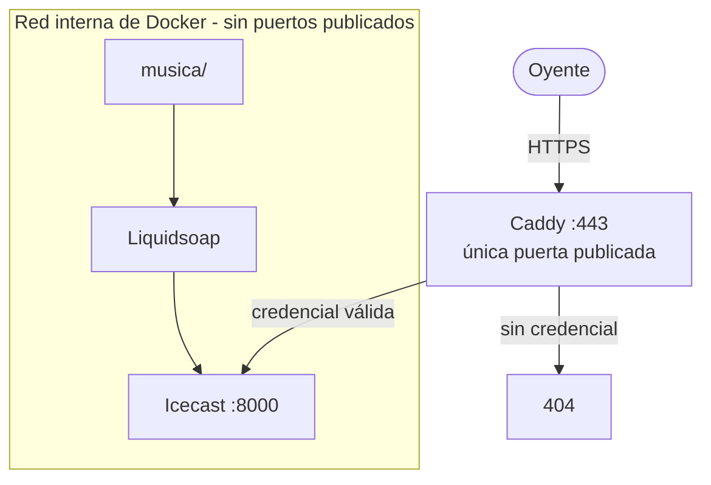
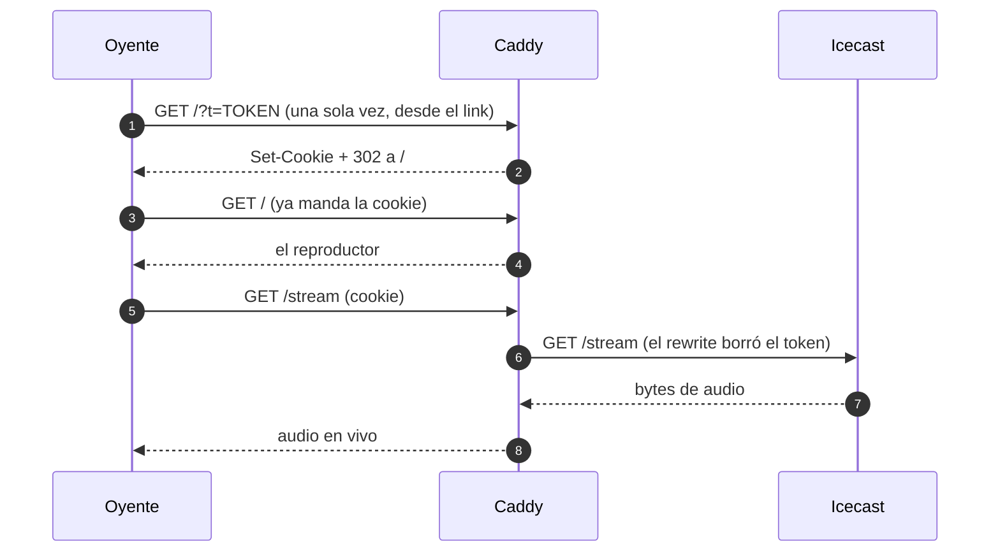

# Radio privada con token

Una radio que existe para un círculo cerrado. Sin credencial, no hay radio.

- **Liquidsoap** reproduce `./music` en orden aleatorio.
- **Icecast** sirve el stream — y **no se anuncia en ningún directorio público**.
- **Caddy** es la única puerta: sin credencial válida responde 404, no 401. No le confirma a nadie que acá hay algo.
- **ffmpeg** convierte el webcam USB en HLS, para que además de escuchar se pueda ver. Video mudo: el audio es el de la radio.

Cada persona recibe **dos credenciales**:

- un **token**, que viaja una sola vez en el link de invitación y sirve también para reproductores (VLC, mpv, ffmpeg);
- una **cookie**, que el navegador recibe al abrir ese link y con la que escucha a partir de ahí. Es lo que evita que el token esté en la barra de direcciones y en los logs en cada reproducción.

Todo open source, todo en un `docker compose up`.

---

## El proyecto

Esta radio transmite desde una laptop en las **Sierras de los Comechingones**.
No es una radio más: todo lo que suena acá lo generamos nosotros, con
software propio, sin samples ni audio de terceros (y por eso $0 en regalías:
ver `PLAN-LEGAL-AR.md`).

La música la produce **indiegenerator**, un generador determinista y offline:
una semilla entra, un tema terminado y etiquetado sale. La misma
`(preset, seed)` produce el mismo plan y, en la misma máquina, el mismo
audio, byte a byte. Volver a escuchar un tema es volver a correr el mismo
número. Cinco carriles (motorik, kosmische, ambient, dub-electronic,
indie-noise) comparten una sola firma de estación.

El software se construye de forma **agéntica, con IA**, sobre el harness de
ingeniería **n3rv** (slices SDD, gates binarios, tests que miden estructura).
Los temas pasan por gates antes de entrar a la radio (−16 LUFS, pico
verdadero ≤ −1.5 dBTP, MP3 128) y se instalan a mano: la radio nunca se
reinicia sola.

El stack (Liquidsoap, Icecast, Caddy, ffmpeg, MediaMTX) es la puerta y el
transporte. El contenido es el nuestro.

---

## Arranque

```bash
cd ~/Work/radio

# 1. Configuración (genera secretos aleatorios)
cp .env.example .env
sed -i "s|^ICECAST_SOURCE_PASSWORD=.*|ICECAST_SOURCE_PASSWORD=$(openssl rand -hex 24)|" .env
sed -i "s|^ICECAST_RELAY_PASSWORD=.*|ICECAST_RELAY_PASSWORD=$(openssl rand -hex 24)|"   .env
sed -i "s|^ICECAST_ADMIN_PASSWORD=.*|ICECAST_ADMIN_PASSWORD=$(openssl rand -hex 24)|"   .env

# 2. Permisos de los scripts
chmod +x scripts/*.sh

# 3. Generar el matcher y darte acceso
#    (crea caddy/tokens.caddy, que NO se versiona porque tiene credenciales)
./scripts/token.sh add yo

# 4. Levantar
docker compose up -d --build

# 5. Verificar que la puerta cierre bien
./scripts/smoke.sh
```

El paso 3 te imprime el link. **Ese link es la llave.** Se abre una vez en
el navegador: el token se canjea por la cookie, la URL queda limpia y a
partir de ahí el token ya no vuelve a viajar.

Si en cambio arrancás de un clon y querés levantar antes de dar acceso,
copiá la plantilla: `cp caddy/tokens.caddy.example caddy/tokens.caddy`
(no dejes que Docker cree el archivo: crearía un directorio).

---

## Dar y sacar acceso

```bash
./scripts/token.sh add juan     # le da acceso a juan y te imprime su link
./scripts/token.sh ls           # quién tiene acceso
./scripts/token.sh rm juan      # le corta el acceso (token y cookie)
./scripts/token.sh regen        # regenera los matchers desde secrets/tokens.txt
```

**Credenciales por persona.** Es la razón de hacerlo así y no con una sola
contraseña compartida: si alguien filtra su link, le cortás el acceso a esa
persona y no le cambiás el link a todas las demás.

`regen` sirve si editás `secrets/tokens.txt` a mano, o después de traerte el
repo a otra máquina.

---

## Agregar música

Copiá los archivos a `./music/`. Entran solos, sin reiniciar nada.

---

## Cómo funciona la puerta

Quién puede hablar con quién. La línea punteada del recuadro es todo lo que
NO está publicado a internet:



Y el canje, paso por paso:



Cuatro capas, y cada una hace algo distinto:

1. **Caddy valida la credencial** contra `caddy/tokens.caddy` (generado).
2. **El canje**: el `?t=...` del link se convierte en cookie y la URL se limpia
   con un 302. A partir de ahí el token no vuelve a viajar.
3. **`rewrite` borra el query** antes de proxear: el token nunca llega a
   Icecast, así que no puede aparecer en sus logs.
4. **Icecast no publica puertos.** Está en la red interna de Docker. Aunque
   alguien encuentre el contenedor, no lo alcanza desde afuera.

Y la radio **no se anuncia en directorios** (`<directory>` ausente en
`icecast.xml` + `<public>0</public>`). No aparece en dir.xiph.org ni en
ningún listado de radios.

---

## La cámara

El webcam entra por la misma puerta que la radio y se ve en un recuadro chico
debajo del botón de play. **Video mudo**: el audio sigue siendo el de la radio.

```
webcam USB (MJPEG 640x480)
   |
   |  ffmpeg: un solo encode a H.264 600 kbps, 15 fps
   +--> RTSP --> MediaMTX --> WebRTC (WHEP)   <- camino principal, <1s
   |
   `--> ./data/cam/ (index.m3u8 + seg*.m4s) --> Caddy --> HLS  <- fallback
```

WebRTC es el camino principal porque HLS no puede ser "en vivo": espera a que
se cierre un segmento. WebRTC manda los frames apenas salen.

### Por qué WebRTC y no seguir con HLS

Medido en esta instalación, no leído en un blog:

| Transporte | Retraso | Cómo se midió |
|---|---|---|
| WebRTC (WHEP) | **<1s** | hora quemada en el cuadro vs reloj real, en una captura del navegador. El jitter buffer solo medía 13-37 ms |
| HLS con hls.js | 1.56s | `hls.latency` estable en 30s |
| HLS nativo de Chrome | ~10s | el mismo stream, sin hls.js |
| MJPEG directo | ~0.2s | descartado: 47 KB por frame = **5.8 Mbps por oyente** |

El piso de HLS es el segmento: ffmpeg no publica nada hasta cerrarlo. Por eso
existe MediaMTX: recibe el H.264 por RTSP desde ffmpeg y lo reparte por RTP.

**La contrapartida, y es real:** la señalización (el SDP) pasa por Caddy y por
el gate como cualquier request, pero **el video no**. Viaja por UDP directo del
navegador a MediaMTX, y Caddy no lo ve. El puerto va atado a `127.0.0.1` en
`docker-compose.yml`: hoy sólo esta máquina. Para LAN hay que publicarlo en
`0.0.0.0` y agregar la IP al `webrtcAdditionalHosts` de `mediamtx/mediamtx.yml`.
Si el UDP no llega, la página **cae sola a HLS**: se ve con 1.5s en vez de
fallar.

Decisiones del fallback, que sigue existiendo para navegadores sin WebRTC:

**fMP4 (`.m4s`) y no MPEG-TS (`.ts`).** Verificado con curl: Caddy sirve los
`.ts` como `text/vnd.trolltech.linguist` —colisión de extensión con Qt— y hay
navegadores que rechazan el segmento por MIME. Los `.m4s` salen como
`video/iso.segment` sin configurar nada.

**hls.js servido desde acá.** Vive en `web/vendor/` y no en un CDN: si la
página le pide un script a un CDN, ese CDN ve quién entra, cuándo y desde qué
IP. Ver `web/vendor/README.md`. Y se carga siempre que haya MSE, aunque el
navegador diga que reproduce HLS nativo: Chrome responde `"maybe"` a
`canPlayType` y su implementación nativa bufferea ~10s sin perilla.

### El presupuesto del fallback HLS

| Etapa | Costo |
|---|---|
| ffmpeg cierra y publica el segmento | 0-1s (`-hls_time 1`) |
| colchón del reproductor detrás del vivo | 1.5s (`liveSyncDuration: 1.5`) |
| decodificar el primer cuadro | ~0.3s |

`new Hls()` sin configurar usa 3 **segmentos** de colchón; con segmentos de 2s
eso eran 6s. Por qué 1.5 y no menos: con 1.0 el `readyState` caía a 2 en
alguna muestra (se quedaba sin buffer en el borde); 1.5 da 1.56s sostenidos,
sin un hipo en 30s.

El pipeline en sí (captura -> encode -> publicar) agrega **50 ms**, medido con
`EXT-X-PROGRAM-DATE-TIME`: el fin del último segmento publicado está 50 ms
atrás del reloj. Todo el resto del retraso es reproductor.

### Cambiar de cámara o de calidad

`CAM_DEVICE` en `.env` viene apuntando al symlink `by-id` de la FaceCam, que
no cambia aunque reconectes el equipo (el número de `/dev/videoN`, en cambio,
depende del orden en que el kernel enumera las cámaras). Resolución y bitrate
están en `cam/capture.sh`: 640x480 a 15 fps, H.264 a 600 kbps.

Si la cámara está desconectada, el contenedor reintenta con backoff y la
página **no muestra el recuadro**: nada de rectángulos negros ni carteles de
error. El audio sigue andando como si nada.

`CAM_CLOCK=1` quema la hora real en el cuadro. No es un adorno: es lo que
permite medir retraso vidrio a vidrio (se compara la hora del video con el
reloj). Apagado por defecto.

### La cámara en VLC, mpv o ffmpeg

El playlist de HLS apunta a otros archivos, y los reproductores los piden
como rutas relativas: si el token va en el query, esos pedidos salen **sin**
el token y comen 404. Por eso la cámara, para reproductores, se pide con el
token en el camino:

```bash
vlc "http://localhost:8090/cam/<TOKEN>/index.m3u8"
```

Los segmentos heredan el prefijo solos. El navegador no necesita esto: usa la
cookie, y así el token no aparece en cada pedido. `token.sh add` te imprime
las dos URLs.

Esto es el **fallback HLS**, con 1.5s. Si querés el stream sin retraso, RTSP
directo a MediaMTX (el puerto 8554 no está publicado: desde esta máquina,
`rtsp://localhost:8554/cam`; para afuera hay que publicarlo y decidir si eso
rompe el "una sola puerta").

---

## Qué tan privado es esto, de verdad

Medido, no supuesto. Lo que sigue está verificado en esta instalación.

**Lo que sí resuelve**
- Nadie llega sin credencial: sin token y sin cookie, todo da 404.
- No aparece en buscadores (`noindex`), ni en directorios de radios.
- El contenido va cifrado (TLS) cuando lo publicás con un dominio.
- Revocás a una persona sin tocarle el link a las demás.
- **El video está detrás del mismo gate que el audio.** Sin credencial,
  `/cam/index.m3u8` y cada segmento dan 404. Verificado en el smoke test.
- **Las credenciales no quedan escritas en los logs.** Caddy redacta la
  cookie por su cuenta (`"Cookie":["REDACTED"]`) y el nivel de log está en
  `ERROR`, así que la URL con `?t=...` tampoco se registra. Verificado: 0
  ocurrencias de ambas tras generar tráfico.

**Lo que NO resuelve**
- El token está en el link de invitación: si alguien lo comparte o lo pega
  en un chat sin cifrar, se filtra. Es el costo de que sea simple.
- Los reproductores (VLC) siguen mandando el token en la URL. Si a vos te
  importa eso, escuchá desde el navegador (cookie) y listo.
- La cámara, en reproductores, necesita el token en el camino
  (`/cam/<token>/...`) y no en el query. No es una concesión: es cómo funciona
  HLS con rutas relativas.
- No oculta tu IP ni tu proveedor. Tu VPS sabe que esto existe.
- Si bajás el nivel de log a `INFO` para debuggear, el token de los
  reproductores sí se escribe. Volvé a `ERROR` después.

**Endurecer (en orden de costo/beneficio)**

1. **Tokens con vencimiento** — `nombre token cookie vence`. Se revoca por
   tiempo solo.
2. **Un dispositivo por credencial** — límite de conexiones simultáneas.
3. **Firmar la cookie** — que la cookie no sea el valor guardado, sino un
   HMAC, para que un volcado de `secrets/tokens.txt` no alcance.
4. **Audio sin costuras** — `crossfade`, jingles, `request.dynamic` para
   pedir temas por chat.

Pedí cualquiera de estas y lo agregamos.

---

## Si lo querés publicar en internet

En `.env`, cambiá:

```
SITE_ADDRESS=radio.daza.ar                          # dónde sirve Caddy
PUBLIC_URL=https://radio.daza.ar                    # la URL que le pasás a la gente
COOKIE_FLAGS=HttpOnly; SameSite=Lax; Secure         # acá SÍ va el flag Secure
```

Y descomentá `email {$ACME_EMAIL}` en `caddy/Caddyfile` (ahí sí sirve el
`ACME_EMAIL` para los avisos de vencimiento del certificado).

**Ojo con `Secure` en la cookie**: hace que el navegador solo la mande por
HTTPS. En local (`http://localhost`) tiene que estar fuera, por eso el
`.env.example` no lo trae. En producción tiene que estar.

En Cloudflare poné el registro **en gris (DNS only)**, nunca en naranja.
La regla de CDN de Cloudflare restringe el contenido no alojado en
Cloudflare, y un stream de audio cae justo ahí.

Caddy saca el certificado solito.

---

## Validar los diagramas

Los diagramas de este README (y del plan legal) son Mermaid. Un error de
sintaxis no se nota hasta que alguien abre el archivo, así que hay un
chequeo:

```bash
./scripts/docs.sh
```

Renderiza cada bloque ` ```mermaid ` de cada `.md` y falla si alguno está
roto, señalando la línea:

```
  OK    PLAN-LEGAL-AR.md       1 diagrama(s)
  FALLA README.md
        Error: Parse error on line 4:
        ...ublicada"]    O -->>|"HTTPS"| C    C -
        ----------------------^
```

Códigos de salida: `0` todo bien, `1` diagrama roto, `2` faltan
dependencias.

La primera vez instala `mermaid-cli` en `~/.cache/radio-docs`, **no en el
proyecto**: son ~450 MB y no tienen por qué vivir acá. Usa el Chrome del
sistema a propósito; si no, además bajaría ~300 MB de Chromium.

Si querés recuperar ese espacio:

```bash
rm -rf ~/.cache/radio-docs
```

**Para que no se te escape en un commit:**

```bash
cat > .git/hooks/pre-commit <<'EOF'
#!/bin/sh
if [ -x ./scripts/docs.sh ]; then
  ./scripts/docs.sh || exit 1
fi
EOF
chmod +x .git/hooks/pre-commit
```

(Ojo con el `|| exit 0`: si lo ponés, el hook *siempre* pasa y no bloquea nada.)

---

## Problemas comunes

**El stream entrega 0 bytes**
```bash
docker compose logs -f liquidsoap
```
Buscá `Connecting to icecast:8000`. Si no aparece, el encoder del `radio.liq`
no está disponible en la imagen. Probá cambiar `%mp3(...)` por:
```liquidsoap
%ffmpeg(format="mp3", %audio(codec="libmp3lame", bitrate=128))
```

**Icecast no arranca**
```bash
docker compose logs icecast
```
Casi siempre es un `ICECAST_*_PASSWORD` vacío en `.env`.

**Con token válido igual da 404**
Caddy no recargó. `./scripts/token.sh add yo` lo hace solo; si no:
```bash
docker compose exec caddy caddy reload --config /etc/caddy/Caddyfile
```

**El link de invitación deja el navegador en 404 para siempre**
Si tu navegador todavía tiene una cookie vieja del tiempo en que el canje
copiaba el token dentro de la cookie, esa cookie no valida nunca más y **no se
pisa sola**: el link nuevo la reemplaza, pero hay que abrir el link una vez.
Abrilo. Si el 404 sigue, entonces sí es lo de arriba (Caddy sin recargar).

**El recuadro de la cámara no aparece**
La página pregunta primero si existe el playlist; si no existe, no muestra
nada (es el caso normal de "cámara desenchufada"). Para saber cuál es:
```bash
docker compose ps cam                      # ¿está arriba?
ls -l data/cam/                            # ¿hay index.m3u8 y seg*.m4s?
curl -s -o /dev/null -w '%{http_code}\n' -H "Cookie: radio=$CK" localhost:8090/cam/index.m3u8
```
Si el contenedor `cam` no arranca al levantar, la cámara está desenchufada:
Docker no puede crear el device y falla fuerte en vez de darte un video vacío.
El audio arranca igual (el error es de ese servicio, no del stack). Sin cámara,
levantá sólo el resto: `docker compose up -d caddy icecast liquidsoap`.

**`failed to create mountpoint for /srv/...: Read-only file system`**
Docker monta los volúmenes ordenados por ruta, así que `./web:/srv:ro` entra
antes que cualquier `/srv/algo`. Después no puede crear el subdirectorio
dentro de un mount de sólo lectura. Por eso los segmentos de la cámara van a
`/srv-cam` y el Caddyfile usa `handle_path`. Nos pasó construyendo esto.

**El video arranca pero se congela**
Buscá `corrupted data` en los logs del contenedor `cam`:
```bash
docker compose logs cam | grep -i corrupto
```
Si aparece en ráfagas cortas y el video fluye, es ruido del driver UVC: se
mide con `ffprobe -count_frames` y el stream entrega los 15 fps igual. Si es
continuo y el video se traba, el problema es de ancho de banda USB: bajá a
320x240 o compartí el puerto con otra cámara que no estés usando.

**El audio se corta solo a los pocos segundos**
La página reconecta sola (hasta 5 intentos) y distingue dos casos: si
`/status-json.xsl` también da 404, es la credencial y reintentar no sirve; si
responde, es red o servidor. Si el cartel dice "respondió 404", pedí un link
nuevo. Si dice "se cortó la conexión", mirá la red. El watchdog vigila que
`currentTime` avance: un corte de red no siempre dispara `error`, el
navegador se queda esperando datos para siempre.

**No suena en el iPhone**
Es la excepción a "MP3 lo reproduce todo" solo si cambiás el encoder a
Opus o Vorbis. Con MP3 128 debería andar en cualquier lado.

**La redirección manda `Location: 302` en vez de `Location: /`**
Caddy lee el primer argumento de `redir` como un *matcher*. `redir / 302`
significa "matcheá `/`, redirigí a `302`". Tiene que ser `redir * / 302`,
con el matcher explícito. Nos pasó construyendo esto.

**Caddy arranca y se muere sin decir por qué**
Mirá primero si el bloque global tiene un token suelto. Esto es un error
real que nos pasó construyendo esto:

```
unrecognized global option: tu@email.com
```

Causa: `{$ACME_EMAIL:}` solo en el bloque global. Caddy lo lee como el
nombre de una opción. Tiene que ser `email {$ACME_EMAIL}`, y solo si el
valor no está vacío. Ver `caddy/Caddyfile`.

**`caddy reload` falla con "connection refused" en :2019**
Alguien puso `admin off`. Eso apaga la API de reload. Dejala activa: está
en localhost *dentro* del contenedor y el compose no publica el 2019.

**Avisos de Icecast que son inofensivos**
- `<hostname> not configured, using default value "localhost"` — Icecast
  avisa así cuando el hostname vale `localhost`. Es exactamente lo que
  queremos (solo lo alcanza Caddy). El aviso es por el YP, que no usamos.
- `Unsupported or legacy stream type: "audio/mpeg"` — Icecast no tiene un
  handler especializado para MP3 y cae al genérico. El audio sale igual.

**Los logs**
Icecast y Caddy escriben a stdout/stderr a propósito, para que `docker
compose logs` los muestre. No los mandes a archivo: si los redirigís,
te quedás ciego justo cuando necesitás ver el error.

---

## Archivos

```
radio/
|-- docker-compose.yml        los cinco servicios
|-- .env.example              plantilla de configuración
|-- icecast/
|   |-- Dockerfile            alpine + icecast (sin imagen de terceros)
|   |-- entrypoint.sh         inyecta los secretos desde el entorno
|   `-- icecast.xml           sin <directory>: no nos anunciamos
|-- liquidsoap/
|   `-- radio.liq             la fuente: playlist -> icecast
|-- cam/
|   |-- Dockerfile            debian + ffmpeg (alpine no trae libx264)
|   `-- capture.sh            webcam -> RTSP (WebRTC) + HLS, con reintentos
|-- caddy/
|   |-- Caddyfile             la puerta
|   `-- tokens.caddy          GENERADO por token.sh
|-- mediamtx/
|   `-- mediamtx.yml          recibe RTSP y publica WebRTC (WHEP)
|-- web/
|   |-- index.html            el reproductor
|   `-- vendor/               hls.js y su licencia. Nada sale a internet
|-- music/                    tu música
|-- data/cam/                 segmentos HLS. Se regeneran solos
|-- scripts/
|   |-- token.sh              alta / baja / listado de accesos
|   |-- smoke.sh              29 verificaciones en 4 grupos
|   `-- docs.sh               valida los diagramas Mermaid
`-- secrets/tokens.txt        QUIÉN tiene acceso. chmod 600.
                              formato: nombre token cookie [vence]
```

`secrets/`, `.env` y `data/` están en `.gitignore`: no se commitean.

---

## Contexto legal

Ver `PLAN-LEGAL-AR.md`. Resumen: con música libre (CC, Banco del INAMU,
producción propia) esto es **$0 y en regla**. Con música comercial,
corresponde licencia de SADAIC y CAPIF SGC.
