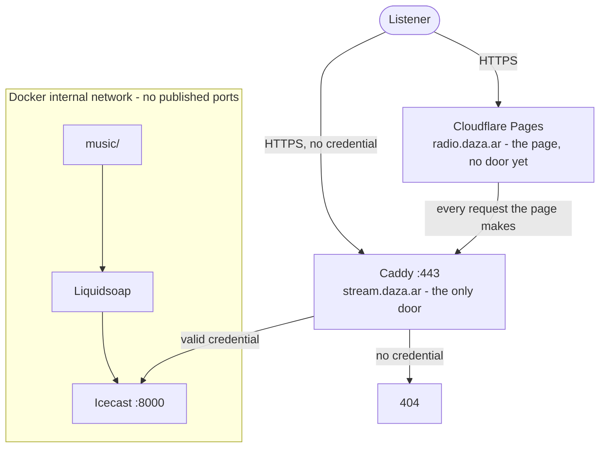
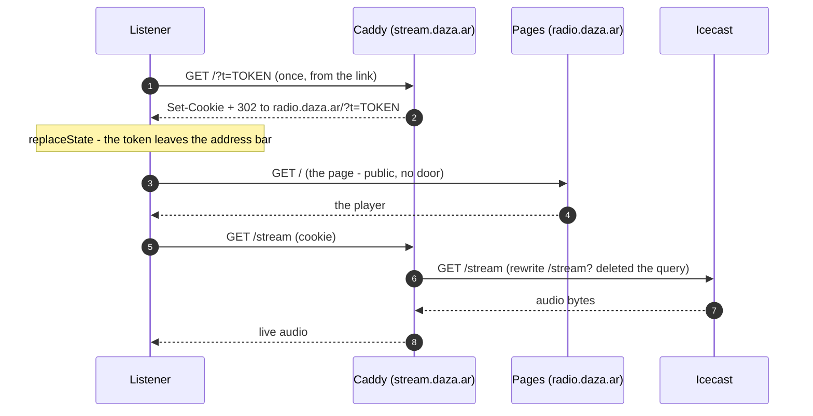

# Private radio with token

A radio that exists for a closed circle. Without a credential, there is no radio.

- **Liquidsoap** plays `./music` in random order.
- **Icecast** serves the stream — and **is not announced in any public
  directory**.
- **Caddy** is the only door to the sound: without a valid credential it
  answers 404, not 401. It does not confirm to anyone that anything exists
  here. The page that holds the player is the known exception: it loads for
  anyone, the radio behind it does not (measured — see *How the door
  works*).
- **ffmpeg** turns the USB webcam into HLS, so that in addition to listening
  you can watch. Muted video: the audio is the radio's.

Each person gets **two credentials**:

- a **token**, which travels once in the invitation link and also serves
  players (VLC, mpv, ffmpeg);
- a **cookie**, which the browser receives when opening that link and uses
  from then on. This keeps the token out of the address bar and out of the
  logs on every playback.

All open source, all in a `docker compose up`.

---

## The project

This radio broadcasts from a laptop in the **Sierras de los Comechingones**.
It is not just another radio: everything you hear here is generated by us,
with our own software, no samples and no third-party audio (and therefore
$0 in royalties — see `PLAN-LEGAL-AR.md`).

The music is produced by **indiegenerator**, a deterministic, offline
generator: a seed goes in, a finished, tagged track comes out. The same
`(preset, seed)` produces the same plan and, on the same machine, the same
audio, byte for byte. Re-listening to a track is re-running the same number.
Five lanes (motorik, kosmische, ambient, dub-electronic, indie-noise) share
a single station signature.

The software is built **agenticly, with AI**, on top of the **n3rv**
engineering harness (SDD slices, binary gates, tests that measure structure).
Tracks pass the gates before entering the radio (−16 LUFS, true peak
≤ −1.5 dBTP, MP3 128) and are installed by hand: the radio never restarts
itself.

The stack (Liquidsoap, Icecast, Caddy, ffmpeg, MediaMTX) is the door and
the transport. The content is ours.

---

## Ever growing

This is the tip, not the whole thing. indiegenerator keeps iterating:
new versions, new slices, new techniques, new gates. The lanes you hear
today are the first pass; the generator keeps evolving, changing, improving.

And this radio is the destination for more than one project. Other
generators, other music, other voices, other noises, other sounds — built in
weird ways — will land on this same stream soon. The door does not change;
what comes through it does.

---

## How a track is born

1. A seed (a number) and a lane (motorik, kosmische, ambient,
   dub-electronic, indie-noise).
2. indiegenerator composes the plan: sections, motifs, strategies, mix.
   The plan is hashed (`plan_sha256`).
3. The plan is rendered to audio: single thread, BLAS at 1 thread, streamed
   arrays to stay under 1.5 GB of RAM.
4. Gates: −16 LUFS, true peak ≤ −1.5 dBTP, MP3 128 without surprises, no
   clipping. If it fails, it does not get in.
5. `validate` → `install`: atomic copy into `music/`. The radio never
   restarts; Liquidsoap picks it up on its own.

The same seed produces the same plan and, on the same machine, the same
audio, byte for byte. `render --from-plan` does not compose: it only
re-renders. Determinism is the property, not a side effect.

---

## The five lanes

| Lane | Weight | Tempo | ARTIST | ALBUM |
|---|---|---|---|---|
| motorik | 30 % | 110–140 | Steady Hand | Sixteen Steps |
| kosmische | 25 % | 70–110 | Hollow Signal | Sustained Weather |
| ambient | 20 % | 112–124 | Long Exposure | Rooms in Half Light |
| dub-electronic | 15 % | 100–130 | Silt | Chamber Echoes |
| indie-noise | 10 % | 90–135 | Tin Roof | Loose Ends |

One motif bank, one palette, one 1/f drift, one strategy deck, one
tempo centre. The identity is in the sound, not the tag.

---

## Start

```bash
cd ~/Work/radio

# 1. Configuration (generates random secrets)
cp .env.example .env
sed -i "s|^ICECAST_SOURCE_PASSWORD=.*|ICECAST_SOURCE_PASSWORD=$(openssl rand -hex 24)|" .env
sed -i "s|^ICECAST_RELAY_PASSWORD=.*|ICECAST_RELAY_PASSWORD=$(openssl rand -hex 24)|"   .env
sed -i "s|^ICECAST_ADMIN_PASSWORD=.*|ICECAST_ADMIN_PASSWORD=$(openssl rand -hex 24)|"   .env

# 2. Script permissions
chmod +x scripts/*.sh scripts/*.js

# 3. Generate the matcher and grant yourself access
#    (creates caddy/tokens.caddy, which is NOT versioned because it holds credentials)
./scripts/token.sh add yo

# 4. Bring it up
docker compose up -d --build

# 5. Verify the door closes properly
./scripts/smoke.sh
```

Step 3 prints the link. **That link is the key.** It is opened once in the
browser: the page exchanges the token for the cookie and then takes it out
of the address bar. From then on the token travels only while the browser
refuses the cookie — then it rides the page's requests, still never the
address bar.

If instead you start from a clone and want to bring it up before granting
access, copy the template: `cp caddy/tokens.caddy.example caddy/tokens.caddy`
(do not let Docker create the file: it would create a directory).

---

## Grant and revoke access

```bash
./scripts/token.sh add juan     # grants access to juan and prints their link
./scripts/token.sh ls           # who has access
./scripts/token.sh rm juan      # cuts access (token and cookie)
./scripts/token.sh regen        # regenerates the matchers from secrets/tokens.txt
```

**Per-person credentials.** That is the reason for doing it this way instead
of a single shared password: if someone leaks their link, you cut access for
that person and do not change the link for everyone else.

`regen` is useful if you edit `secrets/tokens.txt` by hand, or after bringing
the repo to another machine.

---

## Adding music

Copy the files into `./music/`. They are picked up on their own, no restart
needed.

---

## How the door works

Who can talk to whom. The dotted line of the box is everything NOT published
to the internet.

There are two published surfaces since the split, and only one of them is a
door. The page lives on Cloudflare Pages, the radio lives behind Caddy.
Measured 2026-11-09 with no credential: `curl https://radio.daza.ar/`
answers **200** and serves the whole page — byte for byte the file in
`web/index.html` — while every route on `stream.daza.ar` answers **404**.
So anyone can read the station's story; nobody can hear it. The page has no
door yet (issue #2), and `scripts/smoke.sh` measures it as group 0, so the
day it gains one — or the day it loses even that — the smoke goes red
instead of quietly changing meaning.



Locally there is no split: Caddy serves the page too, which is why the
smoke's own `BASE` checks (`localhost:8090`, no credential → 404) pass. The
second door exists only in production.

And the exchange, step by step (production):



Four layers, each doing something different:

1. **Caddy validates the credential** against `caddy/tokens.caddy` (generated).
2. **The exchange**: the `?t=...` of the link becomes a cookie. Caddy's 302
   keeps the `?t=` in the redirect **on purpose** — it is the fallback for a
   browser that refuses the cookie — and the page takes the token out of the
   address bar as soon as it loads. From then on the token travels only in
   the page's requests, and only while that fallback is in use.
3. **The query is deleted before proxying, on two independent layers.**
   `rewrite /stream?` (and the same for `/status-json.xsl` and `/cam/whep`)
   strips `?t=...` so neither Icecast nor MediaMTX ever sees it — the empty
   `?` is what clears it: without it Caddy changes only the path and
   **keeps** the query (issue #7). And even if it ever crossed, Icecast's
   own log format cuts the request at `?` before writing it, so the logs
   could not contain it either. `scripts/query-gate.sh` goes red if the
   first layer stops.
4. **Icecast publishes no ports.** It lives in Docker's internal network. Even
   if someone finds the container, they cannot reach it from outside.

And the radio **is not announced in directories** (`<directory>` absent in
`icecast.xml` + `<public>0</public>`). It does not appear on dir.xiph.org or
in any radio listing.

---

## The camera

The webcam comes in through the same door as the radio and shows in a small
box below the play button. **Muted video**: the audio is still the radio's.

```
webcam USB (MJPEG 640x480)
   |
   |  ffmpeg: single encode to H.264 600 kbps, 15 fps
   +--> RTSP --> MediaMTX --> WebRTC (WHEP)   <- main path, <1s
   |
   `--> ./data/cam/ (index.m3u8 + seg*.m4s) --> Caddy --> HLS  <- fallback
```

WebRTC is the main path because HLS cannot be "live": it waits for a segment
to close. WebRTC sends frames as soon as they come out.

### Why WebRTC instead of staying on HLS

Measured on this installation, not read in a blog:

| Transport | Delay | How it was measured |
|---|---|---|
| WebRTC (WHEP) | **<1s** | time burned into the frame vs real clock, in a browser capture. The jitter buffer only measured 13-37 ms |
| HLS with hls.js | 1.56s | `hls.latency` stable over 30s |
| Chrome native HLS | ~10s | the same stream, without hls.js |
| Direct MJPEG | ~0.2s | discarded: 47 KB per frame = **5.8 Mbps per listener** |

HLS's floor is the segment: ffmpeg publishes nothing until it closes. That is
why MediaMTX exists: it receives H.264 over RTSP from ffmpeg and redistributes
it over RTP.

**The real trade-off:** signalling (the SDP) goes through Caddy and the gate
like any request, but **the video does not**. It travels over direct UDP from
the browser to MediaMTX, and Caddy never sees it. The port is bound to
`127.0.0.1` in `docker-compose.yml`: today only this machine. For LAN you
publish it on `0.0.0.0` and add the IP to `webrtcAdditionalHosts` in
`mediamtx/mediamtx.yml`. If UDP does not arrive, the page **falls back to
HLS on its own**: you see it with 1.5s instead of failing.

Fallback decisions, which still exist for browsers without WebRTC:

**fMP4 (`.m4s`) and not MPEG-TS (`.ts`).** Verified with curl: Caddy serves
`.ts` as `text/vnd.trolltech.linguist` — extension collision with Qt — and
some browsers reject the segment by MIME. `.m4s` come out as `video/iso.segment`
with no configuration.

**hls.js served from here.** It lives in `web/vendor/` and not on a CDN: if
the page asks a CDN for a script, that CDN sees who enters, when, and from
which IP. See `web/vendor/README.md`. And it is always loaded when MSE is
available, even if the browser claims to play HLS natively: Chrome answers
`"maybe"` to `canPlayType` and its native implementation buffers ~10s with no
knob.

### The HLS fallback budget

| Stage | Cost |
|---|---|
| ffmpeg closes and publishes the segment | 0-1s (`-hls_time 1`) |
| player cushion behind live | 1.5s (`liveSyncDuration: 1.5`) |
| decode the first frame | ~0.3s |

`new Hls()` unconfigured uses 3 **segments** of cushion; with 2s segments that
was 6s. Why 1.5 and not less: at 1.0 the `readyState` dropped to 2 on some
samples (it ran out of buffer at the edge); 1.5 gives a steady 1.56s, not a
single hiccup over 30s.

The pipeline itself (capture -> encode -> publish) adds **50 ms**, measured
with `EXT-X-PROGRAM-DATE-TIME`: the end of the last published segment is 50 ms
behind the clock. Everything else in the delay is the player.

### Changing camera or quality

`CAM_DEVICE` in `.env` points at the FaceCam's `by-id` symlink, which does
not change even if you reconnect the equipment (the `/dev/videoN` number, on
the other hand, depends on the order the kernel enumerates cameras).
Resolution and bitrate are in `cam/capture.sh`: 640x480 at 15 fps, H.264 at
600 kbps.

If the camera is disconnected, the container retries with backoff and the page
**shows no box**: no black rectangles and no error banners. Not because the
container is up — because the `index.m3u8` it would have left behind is either
gone or stale (`EXT-X-PROGRAM-DATE-TIME` older than ~10 s). The audio keeps
going as if nothing happened.

`CAM_CLOCK=1` burns the real time into the frame. It is not decoration: it is
what allows measuring glass-to-glass delay (the video's time is compared with
the clock). Off by default.

### The camera in VLC, mpv or ffmpeg

The HLS playlist points to other files, and players request them as relative
paths: if the token is in the query, those requests go out **without** the
token and get 404. That is why the camera, for players, is requested with the
token in the path:

```bash
vlc "http://localhost:8090/cam/<TOKEN>/index.m3u8"
```

Segments inherit the prefix on their own. The browser does not need this: it
uses the cookie, so the token does not appear on every request. `token.sh add`
prints both URLs.

This is the **HLS fallback**, with 1.5s. If you want the stream without delay,
RTSP direct to MediaMTX (port 8554 is not published: from this machine,
`rtsp://localhost:8554/cam`; from outside you have to publish it and decide
whether that breaks the "single door").

---

## How private this really is

Measured, not assumed. What follows is verified on this installation.

**What it does solve**
- Nobody gets in without a credential: without token and without cookie,
  everything the radio serves — stream, status, camera — returns 404. (The
  page in front of it does not; see "What it does NOT solve".)
- It does not appear in search engines (`noindex`), nor in radio directories.
- Content is encrypted (TLS) when published with a domain.
- You revoke one person without touching anyone else's link.
- **The video is behind the same gate as the audio.** Without a credential,
  `/cam/index.m3u8` and every segment return 404. Verified in the smoke test.
- **Credentials are not written to the logs.** Caddy redacts the cookie on
  its own (`"Cookie":["REDACTED"]`) and the log level is `ERROR`, so the URL
  with `?t=...` is not logged either. Verified: 0 occurrences of both after
  generating traffic.

**What it does NOT solve**
- **The page has no door.** `https://radio.daza.ar/` serves the whole player
  to anyone with no credential (measured: 200, issue #2). Everything behind
  it — stream, status, camera — still answers 404, but the station's story
  is readable by whoever guesses the name. `smoke.sh` group 0 measures this,
  so it cannot change without going red.
- The token is in the invitation link: if someone shares it or pastes it into
  an unencrypted chat, it leaks. That is the cost of keeping it simple.
- Players (VLC) keep sending the token in the URL. If that matters to you,
  listen from the browser (cookie) and you are done.
- The camera, in players, needs the token in the path
  (`/cam/<token>/...`) and not in the query. That is not a concession: that
  is how HLS works with relative paths.
- It does not hide your IP or your provider. Your VPS knows this exists.
- If you lower the log level to `INFO` for debugging, the players' tokens are
  written. Go back to `ERROR` afterwards.

**Hardening (in cost/benefit order)**

1. **Expiring tokens** — `name token cookie expires`. Revoked by time alone.
2. **One device per credential** — limit on simultaneous connections.
3. **Signed cookie** — the cookie is not the stored value but an HMAC, so a
   dump of `secrets/tokens.txt` is not enough.
4. **Seamless audio** — `crossfade`, jingles, `request.dynamic` to request
   tracks by chat.

Ask for any of these and we add it.

---

## If you want to publish it on the internet

Since the split, the player's page and the radio **live on different
places**: Cloudflare Pages serves the page; the gate (Caddy, Icecast,
everything behind it) lives behind a tunnel. So `SITE_ADDRESS` is no
longer where the link lands — the invitation redirects out from the
backend to the page. Write the split down in `.env`:

```
SITE_ADDRESS=stream.daza.ar                # where the gate listens (tunnel)
FRONTEND_URL=https://radio.daza.ar         # where the anonymous player lives
PUBLIC_URL=https://stream.daza.ar          # the URL you give people (invitations)
COOKIE_FLAGS=HttpOnly; SameSite=Lax; Secure # here Secure DOES go
```

`FRONTEND_URL` is the one knob that matters for the split: Caddy's
`canje` redirect points there, and every CORS header the page needs is
inserted from the same value. There is exactly one documented
`radio.daza.ar` line in the tree — the production example in
`.env.example` — and `scripts/claims.sh` keeps it that way.

And uncomment `email {$ACME_EMAIL}` in `caddy/Caddyfile` (there the
`ACME_EMAIL` is actually used for certificate expiry notices).

**Careful with `Secure` on the cookie**: it makes the browser send it only
over HTTPS. Locally (`http://localhost`) it must be off, which is why
`.env.example` does not include it. In production it must be on.

**The record is grey (DNS only), never orange**, for `stream.daza.ar`
(the tunnel). Cloudflare's CDN rule restricts content not hosted on
Cloudflare, and an audio stream falls right there. The frontend, by
contrast, **is** hosted by Cloudflare (Pages builds it from `master`
and `radio.daza.ar` is the project's alias) — push a change to `web/`
and it lands in production.

Caddy gets the certificate on its own.

---

## Validating the diagrams

The diagrams in this README (and in the legal plan) are Mermaid. A syntax
error is not noticed until someone opens the file, so there is a check:

```bash
./scripts/docs.sh
```

It renders every ` ```mermaid ` block of every `.md` and fails if any is
broken, pointing at the line:

```
  OK    PLAN-LEGAL-AR.md       1 diagram(s)
  FAIL  README.md
        Error: Parse error on line 4:
        ...ublicada"]    O -->>|"HTTPS"| C    C -
        ----------------------^
```

Exit codes: `0` all good, `1` broken diagram, `2` missing dependencies.

The first time it installs `mermaid-cli` in `~/.cache/radio-docs`, **not in
the project**: about 450 MB that do not need to live here. It deliberately
uses the system Chrome; otherwise it would also download ~300 MB of Chromium.

If you want to reclaim that space:

```bash
rm -rf ~/.cache/radio-docs
```

---

## Validating the player

`web/index.html` has no build and no test runner, so the structure of its
state machine is checked the same way the diagrams are checked: measured,
not eyeballed.

```bash
./scripts/ui-gate.js
```

It extracts the `<script>` from the page and runs it against a fake DOM and a
fake `fetch`, then counts what reading alone does not show: how many status
fetches happen per tick, how many times `#now` is written, and what the label
does while a reconnection chain is in flight (the chain outranks the tick —
that is the rule, and this is where it is enforced). It also renders both
shapes of `icestats.source` (object and array) and fails if they disagree.

The fake `fetch` can also answer 404, 502 or nothing at all, so the page's
verdict matrix is measured row by row: `200` with source, `200` without,
`404` (the door closed) and a network failure (which must not claim
anything — no "off air", no disabled button while the audio plays). The door's
sentence is asserted verbatim, and it must appear **once** in the source: the
chain and the tick write the same fact, so they cannot be allowed to drift
apart. The fake `fetch` can also be told the cookie is dead — then any
request *without* the token gets a 404, which is how the fallback is
measured — and the stub carries a mutable `location` plus a real
`history.replaceState`, so "the token leaves the address bar" is a reading,
not a hope: the gate reads the bar and every status URL, before and after.

The same stub measures what the station's voice needed (F-10 / F-11 / F-16):
every visible string lives in one `STR` object — the gate asserts that no
content reaches `textContent`/`innerHTML` as a hand-written literal, that
`lang` matches the copy, that `aria-live="polite"` sits on `estado`/`err`/
`aviso`, and that the button's `aria-label` travels with the state
(`Play` ↔ `Pause`). And the autoplay policy case is a scenario of its own:
`play()` rejects with `NotAllowedError` and the dedicated copy must appear —
not "stopped", not silence, not an eternal "reconnecting".

The chain's own question (`/status-json.xsl`, the one that decides credential
versus network) is bounded. The stub can swallow that request — a black-holed
connection that never resets, which is the failure the watchdog exists for —
and the page used to wait forever on it: `reintentando` stayed true, so the
tick, `ended` and `error` were all swallowed, and the page looked alive with no
banner and no counter. The gate now hangs the stub and demands the opposite:
a declared bound, a request that carries a `signal`, the frozen page while the
bound has not fired, and the chain reaching **attempt 1** once it does. The
number in the source is the one the gate reads — `3000`, 9× the p95 of 40
measured requests (333 ms through the tunnel, 195 ms on the box's loopback),
8× the maximum, in the same order as the watchdog's 3 s window. A bound
written twice, an abort read as "the door", or the bound's `signal` pasted
onto the shared options object (where an aborted one would kill every later
tick) all go red.

The listener's hand outranks the chain, and that is measured too. The button
is the only way to say "stop" or "try now", so a click cancels the scheduled
attempt, renews the budget and does exactly one thing: pause if it is playing,
one attempt if it is not. Two bugs died there: a manual retry after the five
attempts were spent used to get **zero** further retries (the counter was
already exhausted, so the first failure went straight back to the banner,
although the comment promised a fresh budget), and a retry already scheduled
kept running after the listener pressed pause — the radio started itself.
The stub counts `play()` calls, so "one attempt in flight" is a number: click
during the wait → one attempt starts, the scheduled one is cancelled, and
running the clock afterwards starts no second one; pause by hand → a later
`error` starts nothing; `Play` lights it up again.

```
UI gate — web/index.html

un solo tick de estado:
  OK    al cargar la pagina: exactamente 1 fetch de estado
  OK    15 s: el tick hace exactamente 1 fetch
  OK    15 s: #now se escribe 1 vez

la cadena de reconexion manda sobre el tick:
  OK    tick en vivo: el cartel NO pasa a live

la mano del oyente manda sobre la cadena (F-17 / F-18):
  OK    agotado el presupuesto: cartel definitivo
  OK    el reintento manual empieza en (1/5), no choca con el contador agotado
  OK    el click arranca UN intento, ya
  OK    y el agendado quedó cancelado
  OK    la cadena no lo resucita

la matriz del tick al cargar (F-03 / F-04):
  OK    404 -> la frase exacta de la puerta
  OK    red caida -> no pinta nada: ni off air, ni puerta, ni boton muerto

el token sale de la barra (F-01):
  OK    cookie viva: la barra queda limpia al cargar (quedo "")
  OK    cookie viva: NINGUN pedido lleva el token
  OK    cookie muerta: la barra TAMBIEN queda limpia (quedo "")
  OK    502: la barra se queda como estaba — 502 no prueba nada

el cartel de la estación, en una sola voz (F-10 / F-11):
  OK    ni una frase visible escrita a mano fuera de STR
  OK    aria-live="polite" en #estado

el autoplay bloqueado dice lo que es (F-16):
  OK    play() rechazado con NotAllowedError -> la copia dedicada, NO el silencio

la encuesta de credencial tiene cota (F-09):
  OK    el pedido lleva signal: se puede cortar
  OK    la cota de 3000 ms quedó armada (1)
  OK    colgada: el tick mide pero no pinta
  OK    la cota dispara: la cadena avanza sola
  OK    llegó al intento 1 (1/5)

la cámara, la pregunta antes del arranque (F-08):
  OK    playlist 404 -> la caja NO aparece
  OK    playlist 404 -> cero loads de hls.js
  OK    playlist vieja (>10 s) -> la caja NO aparece

Todo bien - 134 chequeos.
```

Exit codes: `0` all good, `1` a check failed. No network, no stack running:
only `node`, the dependency `docs.sh` already had. Every check is binary, so
the gate can fail: against the pre-S1 page 12 checks go red, against the
pre-S2 page 13 do, against the pre-S3 page 13 do, against the page before
F-17/F-18 6 do (the exhausted budget, the uncancelled retry, the radio coming
back on its own), against the pre-S10 page 7 do (no bound, no `signal`, the
chain never reaches attempt 1), and against the pre-S7 page it fails before a
single check runs — the ids its new checks measure are no longer there.

### Proving that it can fail

A green gate proves nothing if nobody has ever seen it go red. That is how a
check ended up measuring a phantom element instead of the page — the stub
invented the `btn` id it was asked for, and the row passed for nothing
(issue #23). So the gate carries its own proof:

```bash
./scripts/ui-gate.js --self-test
```

It breaks the page's source **in memory**, one guarantee per mutation, twenty in
all: a second status tick, the chain guard dropped, the `404` read as any
other response, the transient lie restored, the two endpoint shapes read
differently, the door's sentence written twice — and, for the camera: the playlist considered forever fresh; for the token out of
the address bar: the bar never cleaned, the suffix cleared despite a dead
cookie, the cookie probe arriving already carrying the token, and a `502`
read as a decision. For the station's voice: an autoplay blocked by the
browser swallowed into silence, and a phrase visible somewhere that it is
not in `STR`. For the bounded probe: the bound removed (the chain hangs
forever again), the abort read as the door, the constant declared twice, and
its `signal` pasted onto the shared options object. For the listener's hand:
the click not cancelling the scheduled retry (the radio comes back on its
own), the click not renewing the budget (the comment lies again), and the
chain resurrecting a radio that was paused by hand. It then demands **red on every
mutation** and **green on the real page**. A mutation that stays green means
the gate stopped measuring that thing — that is a failure, not a pass. A
mutation that no longer applies, because the code changed shape, fails too: a
blind gate is not a lucky one. Nothing is written to disk, so there is nothing
to restore and no chance of committing a mutated page.

```
Self-test — ¿puede fallar este gate?

  OK    pagina real .......................... 134/134 en verde
  OK    un segundo tick de 15 s (la regla de un solo fetch por tick)
          9 rojos, p.e. "un solo intervalo consulta el estado (15000 ms); encontrados: [15000, 15000]"
  OK    la cadena deja de mandar sobre el tick
          3 rojos, p.e. "tick en vivo: el cartel NO pasa a live"
  OK    la barra nunca se limpia (el t se queda en la direccion)
          5 rojos, p.e. "cookie viva: la barra queda limpia al cargar (quedo "?t=f00dfeed")"
  OK    la encuesta de credencial vuelve a no tener cota (F-09: se cuelga para siempre)
          4 rojos, p.e. "la cota de 3000 ms quedó armada (0)"
  OK    el click no cancela el reintento agendado (la radio vuelve sola)
          2 rojos, p.e. "y el agendado quedó cancelado"

Todo bien - 20 mutaciones atrapadas.
```

Exit codes: `0` twenty mutations trapped, `1` one went uncaught or did not
apply. Twenty-one runs of the gate, about 1.5 s.

**So neither slips past in a commit:**

```bash
cat > .git/hooks/pre-commit <<'EOF'
#!/bin/sh
if [ -x ./scripts/docs.sh ]; then
  ./scripts/docs.sh || exit 1
fi
if [ -x ./scripts/ui-gate.js ]; then
  ./scripts/ui-gate.js || exit 1
  ./scripts/ui-gate.js --self-test || exit 1
fi
EOF
chmod +x .git/hooks/pre-commit
```

(Careful with `|| exit 0`: if you put it there, the hook *always* passes and
blocks nothing.)

---

## Validating the query

The token's `?t=...` must not cross the door. The README used to say that
`rewrite` stripped it — but `rewrite /stream` only changes the path and
**keeps** the query; what clears it is the empty `?` (`rewrite /stream?`).
Without it, `?t=` reached Icecast and MediaMTX on every request (issue #7),
and the smoke grep for `stream?t=` in Icecast's logs could not notice: the
log format cuts the request at `?` before writing it, so the string was
unreachable — green or red without measuring anything.

```bash
./scripts/query-gate.sh
```

It lifts the three `handle` blocks out of the deployed `Caddyfile` — the
production blocks verbatim, only the upstream address is swapped for a
local origin that writes down every request line it receives — runs the
pinned Caddy image against them and demands that **no `?` arrives** on
`/stream`, `/status-json.xsl` and `/cam/whep`. Then it removes the `?`
from each rewrite, one at a time — the config as it was before S4 — and
demands that the leak **appears**. A mutation that stays clean means the
gate stopped measuring that route: a failure, not a pass.

```
Query gate — el query no cruza la puerta (F-07)

  OK Caddyfile: /stream tiene 'rewrite /stream?' dentro de su bloque
  OK Caddyfile: /status-json.xsl tiene 'rewrite /status-json.xsl?' dentro de su bloque
  OK Caddyfile: /cam/whep tiene 'rewrite /cam/whep?' dentro de su bloque
  OK /stream: el origin recibio 'GET /stream' — sin '?', sin token
  OK /status-json.xsl: el origin recibio 'GET /status-json.xsl' — sin '?', sin token
  OK /cam/whep: el origin recibio 'POST /cam/whep' — sin '?', sin token
  OK mutacion /stream: sin el '?', el query llego ('GET /stream?t=SECRETO') — este gate puede fallar
  OK mutacion /status-json.xsl: sin el '?', el query llego ('GET /status-json.xsl?t=SECRETO') — este gate puede fallar
  OK mutacion /cam/whep: sin el '?', el query llego ('POST /cam/whep?t=SECRETO') — este gate puede fallar

Todo bien — 9 chequeos.
```

Exit codes: `0` three clean routes and three mutations trapped, `1`
something measured something else, `2` missing dependencies (docker,
python3, the Caddy image). No stack and no `.env` — only the Docker
daemon — and it takes about 5 s. `CADDYFILE=/otro/Caddyfile` points it at
another version: against the file as it was before S4
(`git show a2f34e7:caddy/Caddyfile`) the three structural checks go red.

Being fast and stack-free, it can join the pre-commit hook above.

---

## One origin, one place

The frontend is a static page, the backend lives behind the tunnel —
between them, nothing should hold the domain written out by hand. It
used to be in seven places across three languages: Caddyfile (the
canje and every CORS block), the JS, and the smoke test. A domain rename
would be a hunt, and every copy was a chance to assert the wrong origin
(issue #13). One knob, four consumers:

```bash
./scripts/claims.sh
```

`FRONTEND_URL` in `.env` is the one seam — the canje's redirect target,
the CORS origin of the Caddyfile, the frontend origin the smoke test
curls, the assertion that the invitation's `Location` matches the
configured origin. `claims.sh` measures it: the exact
`radio.daza.ar` occurrences still standing in the deployable tree are
an audited allowlist of two lines (the production example line in
`.env.example`, and the station's firma in the About page — prose, not
configuration). Any new one is red on introduction, not found in a
hunt a year from now.

---

## Deploying the backend on push

The frontend deploys itself: every push to `master` builds on
Cloudflare Pages (`build_command: exit 0`, `destination_dir: web`)
and `radio.daza.ar` is live with the new page within a minute.

The backend is the machine that runs the compose project, and it
follows master in the same push — without a cron and without a
self-hosted runner. git has no `post-push` hook, but the box has the
right one: a **`post-receive`** hook on its checked-out clone.

`origin` has two push destinations. GitHub gets the repo (and Pages
deploys the frontend); the backend box gets the push over SSH, and
git itself fast-updates the working tree (`receive.denyCurrentBranch=
updateInstead`), so the working tree IS the deployment and no
credentials ever live on it for this path:

- a push to master fast-forwards the box's clone and updates its
  working tree — the exact commit, post-pull;
- the `post-receive` hook then does exactly one thing en caliente:
  if `caddy/Caddyfile` or `caddy/tokens.caddy` changed, `caddy reload`
  inside the container — graceful, listeners and streams stay up;
- everything else is pull-only and never restarted by a push.
  `web/` is read by Caddy as files (and Pages deploys it anyway).
  `cam/`, `liquidsoap/`, `mediamtx/` are not touched: restarting
  Liquidsoap drops the stream — that is a human decision, not one a
  push gets to make;
- every run appends to `data/deploy.log` (what came in, what was
  reloaded, or why it stopped). If the reload fails, the previous
  config keeps serving and the log says so loudly.

One hard-earned note — **why `./caddy` is mounted as a directory and
not as individual files**: Docker bind-mounts pin the inode, and git
updates the working tree by rename-swap (a new inode), so a file-mounted
`Caddyfile` in the container stayed pinned to whatever it held when
the container was created — graceful reloads ever after loaded the
*ancient* config without a word (the box had the S4 query-strip and a
CORS hotfix that never actually took effect this way). `tokens.caddy`
never showed the problem because it is generated in place (`cat > …`,
same inode — the house rule in scripts/token.sh). Mounting the
directory (like `./web`) makes git's swaps visible to the container
and keeps every reload genuinely graceful, no recreate.

Wiring it on a new box (or after a rebuild), once:

```bash
cd ~/servers/radio
HOOKS=$(git rev-parse --git-path hooks)
cp scripts/post-receive "$HOOKS/post-receive"
chmod +x "$HOOKS/post-receive"
# Absolute hooksPath, always: client-side hooks resolve a relative
# path against the worktree, receive hooks resolve it against the git
# dir — relative paths split the two. Set it absolute and both agree.
git config core.hooksPath "$(pwd)/.githooks"
git config receive.denyCurrentBranch updateInstead
docker compose up -d caddy   # one-time, door blinks ~2s — mounts flip to the directory
```

(`--git-path hooks` resolves the real hooks directory even when the
repo sets `core.hooksPath`; this box uses `.githooks`, so calling
`--git-path` instead of assuming `.git/hooks` is what keeps the hook
firing.)

And on the machine you push from — the second destination:

```bash
git remote set-url --add --push origin 'git@THE-BOX:THE-REPO-DIR'
```

Plain `git push` stays the same command; it now lands in both places.
Pushing from any machine without the destination (GitHub web, another
laptop) leaves the backend behind — syncing it is just making a push
from a configured machine.

---

## Common problems

**The stream delivers 0 bytes**
```bash
docker compose logs -f liquidsoap
```
Look for `Connecting to icecast:8000`. If it does not appear, the encoder in
`radio.liq` is not available in the image. Try changing `%mp3(...)` to:
```liquidsoap
%ffmpeg(format="mp3", %audio(codec="libmp3lame", bitrate=128))
```

**Icecast does not start**
```bash
docker compose logs icecast
```
Almost always an empty `ICECAST_*_PASSWORD` in `.env`.

**404 even with a valid token**
Caddy did not reload. `./scripts/token.sh add yo` does it on its own; if not:
```bash
docker compose exec caddy caddy reload --config /etc/caddy/Caddyfile
```

**The invitation link leaves the browser on 404 forever**
If your browser still has an old cookie from the time the exchange copied the
token inside the cookie, that cookie never validates again and **is not
overwritten on its own**: the new link replaces it, but you have to open the
link once. Open it. If the 404 persists, then it is the above (Caddy not
reloaded).

**The camera box does not appear**
The page first asks whether the playlist exists; if it does not, it shows
nothing (that is the normal case of "camera unplugged"). To find out which:
```bash
docker compose ps cam                      # is it up?
ls -l data/cam/                            # is there index.m3u8 and seg*.m4s?
CK=$(awk 'NF>=3 {print $3; exit}' secrets/tokens.txt)
curl -s -o /dev/null -w '%{http_code}\n' -H "Cookie: radio=$CK" localhost:8090/cam/index.m3u8
```
If the `cam` container does not start on bring-up, the camera is unplugged:
Docker cannot create the device and fails hard instead of giving you empty
video. The audio starts anyway (the error is in that service, not the stack).
Without a camera, bring up only the rest: `docker compose up -d caddy icecast liquidsoap`.

**`failed to create mountpoint for /srv/...: Read-only file system`**
Docker mounts volumes ordered by path, so `./web:/srv:ro` comes before any
`/srv/...`. Afterwards it cannot create the subdirectory inside a read-only
mount. That is why the camera segments go to `/srv-cam` and the Caddyfile
uses `handle_path`. It happened to us building this.

**The video starts but freezes**
Look for `corrupted data` in the `cam` container logs:
```bash
docker compose logs cam | grep -i corrupto
```
If it appears in short bursts and the video flows, it is UVC driver noise:
measured with `ffprobe -count_frames` and the stream still delivers the 15
fps. If it is continuous and the video stalls, the problem is USB bandwidth:
drop to 320x240 or share the port with another camera you are not using.

**The audio cuts out after a few seconds**
The page reconnects on its own (up to 5 attempts) and distinguishes two
cases: if `/status-json.xsl` also returns 404, it is the credential and
retrying is pointless; if it responds, it is network or server. If the banner
says "replied 404", ask for a new link. If it says "connection dropped",
look at the network. The watchdog watches `currentTime` advance: a network
cut does not always fire `error`, the browser waits for data forever. That
question itself is bounded at 3 s: a connection that swallows the request
(cuts the audio, never answers) is read as the network after that, so the
chain always reaches its first attempt instead of waiting on a request that
will never come back. The button belongs to the listener: pressing **Play**
cancels whatever was scheduled and starts a fresh budget of 5; pressing
**Pause** stops the chain for good — nothing restarts the audio behind your
back.

**No sound on iPhone**
It is the exception to "MP3 plays everywhere" only if you change the encoder
to Opus or Vorbis. With MP3 128 it should work anywhere.

**The redirect sends `Location: 302` instead of `Location: /`**
Caddy reads the first argument of `redir` as a *matcher*. `redir / 302`
means "match `/`, redirect to `302`". It has to be `redir * / 302`, with
the explicit matcher. It happened to us building this.

**Caddy starts and dies without saying why**
Look first at whether the global block has a stray token. This is a real
error that happened to us building this:

```
unrecognized global option: tu@email.com
```

Cause: `{$ACME_EMAIL:}` alone in the global block. Caddy reads it as the
name of an option. It has to be `email {$ACME_EMAIL}`, and only if the value
is not empty. See `caddy/Caddyfile`.

**`caddy reload` fails with "connection refused" on :2019**
Someone set `admin off`. That turns off the reload API. Leave it active: it
is on localhost *inside* the container and compose does not publish 2019.

**Harmless Icecast warnings**
- `<hostname> not configured, using default value "localhost"` — Icecast
  warns like this when hostname is `localhost`. That is exactly what we want
  (only Caddy reaches it). The warning is from YP, which we do not use.
- `Unsupported or legacy stream type: "audio/mpeg"` — Icecast has no
  specialised handler for MP3 and falls back to the generic one. The audio
  comes out anyway.

**The logs**
Icecast and Caddy write to stdout/stderr on purpose, so `docker compose
logs` shows them. Do not send them to a file: if you redirect them, you go
blind exactly when you need to see the error.

---

## Files

```
radio/
|-- docker-compose.yml        the five services
|-- .env.example              configuration template
|-- icecast/
|   |-- Dockerfile            alpine + icecast (no third-party image)
|   |-- entrypoint.sh         injects secrets from the environment
|   `-- icecast.xml           no <directory>: we do not announce
|-- liquidsoap/
|   `-- radio.liq             the source: playlist -> icecast
|-- cam/
|   |-- Dockerfile            debian + ffmpeg (alpine has no libx264)
|   `-- capture.sh            webcam -> RTSP (WebRTC) + HLS, with retries
|-- caddy/
|   |-- Caddyfile             the door
|   `-- tokens.caddy          GENERATED by token.sh
|-- mediamtx/
|   `-- mediamtx.yml          receives RTSP and publishes WebRTC (WHEP)
|-- web/
|   |-- index.html            the player
|   `-- vendor/               hls.js and its license. Nothing goes to the internet
|-- music/                    your music
|-- data/cam/                 HLS segments. Regenerated on their own
|-- scripts/
|   |-- token.sh              grant / revoke / list access
|   |-- smoke.sh              33 checks in 5 groups (group 0: the public page)
|   |-- post-receive          after a push: log it, reload Caddy iff the Caddyfile changed
|   |-- query-gate.sh         the token's query never crosses the door
|   |-- claims.sh             one-origin claim: nobody writes the domain out by hand
|   |-- docs.sh               validates the Mermaid diagrams
|   `-- ui-gate.js            structure of the player's state machine
`-- secrets/tokens.txt        WHO has access. chmod 600.
                              format: name token cookie [expires]
```

`secrets/`, `.env` and `data/` are in `.gitignore`: they are not committed.

---

## Legal context

See `PLAN-LEGAL-AR.md`. Summary: with free music (CC, INAMU bank, own
production) this is **$0 and in order**. With commercial music, a SADAIC
and CAPIF SGC license applies.