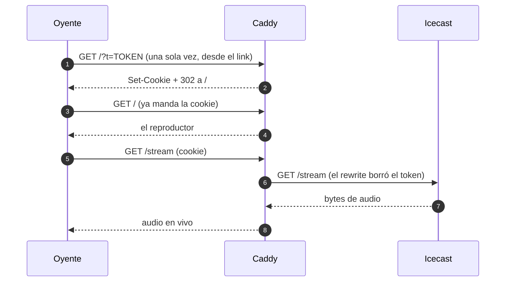

# Radio privada con token

Una radio que existe para un círculo cerrado. Sin credencial, no hay radio.

- **Liquidsoap** reproduce `./music` en orden aleatorio.
- **Icecast** sirve el stream — y **no se anuncia en ningún directorio público**.
- **Caddy** es la única puerta: sin credencial válida responde 404, no 401. No le confirma a nadie que acá hay algo.

Cada persona recibe **dos credenciales**:

- un **token**, que viaja una sola vez en el link de invitación y sirve también para reproductores (VLC, mpv, ffmpeg);
- una **cookie**, que el navegador recibe al abrir ese link y con la que escucha a partir de ahí. Es lo que evita que el token esté en la barra de direcciones y en los logs en cada reproducción.

Todo open source, todo en un `docker compose up`.

---

## Arranque

```bash
cd ~/Work/radio

# 1. Configuración (genera secretos aleatorios)
cp .env.example .env
sed -i "s|^ICECAST_SOURCE_PASSWORD=.*|ICECAST_SOURCE_PASSWORD=$(openssl rand -hex 24)|" .env
sed -i "s|^ICECAST_RELAY_PASSWORD=.*|ICECAST_RELAY_PASSWORD=$(openssl rand -hex 24)|"   .env
sed -i "s|^ICECAST_ADMIN_PASSWORD=.*|ICECAST_ADMIN_PASSWORD=$(openssl rand -hex 24)|"   .env

# 2. Permisos de los scripts
chmod +x scripts/*.sh

# 3. Levantar
docker compose up -d --build

# 4. Darte acceso a vos
./scripts/token.sh add yo

# 5. Verificar que la puerta cierre bien
./scripts/smoke.sh
```

El paso 4 te imprime el link. **Ese link es la llave.** Se abre una vez en
el navegador: el token se canjea por la cookie, la URL queda limpia y a
partir de ahí el token ya no vuelve a viajar.

---

## Dar y sacar acceso

```bash
./scripts/token.sh add juan     # le da acceso a juan y te imprime su link
./scripts/token.sh ls           # quién tiene acceso
./scripts/token.sh rm juan      # le corta el acceso (token y cookie)
./scripts/token.sh regen        # regenera los matchers desde secrets/tokens.txt
```

**Credenciales por persona.** Es la razón de hacerlo así y no con una sola
contraseña compartida: si alguien filtra su link, le cortás el acceso a esa
persona y no le cambiás el link a todas las demás.

`regen` sirve si editás `secrets/tokens.txt` a mano, o después de traerte el
repo a otra máquina.

---

## Agregar música

Copiá los archivos a `./music/`. Entran solos, sin reiniciar nada.

---

## Cómo funciona la puerta

Quién puede hablar con quién. La línea punteada del recuadro es todo lo que
NO está publicado a internet:


Y el canje, paso por paso:



Cuatro capas, y cada una hace algo distinto:

1. **Caddy valida la credencial** contra `caddy/tokens.caddy` (generado).
2. **El canje**: el `?t=...` del link se convierte en cookie y la URL se limpia
   con un 302. A partir de ahí el token no vuelve a viajar.
3. **`rewrite` borra el query** antes de proxear: el token nunca llega a
   Icecast, así que no puede aparecer en sus logs.
4. **Icecast no publica puertos.** Está en la red interna de Docker. Aunque
   alguien encuentre el contenedor, no lo alcanza desde afuera.

Y la radio **no se anuncia en directorios** (`<directory>` ausente en
`icecast.xml` + `<public>0</public>`). No aparece en dir.xiph.org ni en
ningún listado de radios.

---

## Qué tan privado es esto, de verdad

Medido, no supuesto. Lo que sigue está verificado en esta instalación.

**Lo que sí resuelve**
- Nadie llega sin credencial: sin token y sin cookie, todo da 404.
- No aparece en buscadores (`noindex`), ni en directorios de radios.
- El contenido va cifrado (TLS) cuando lo publicás con un dominio.
- Revocás a una persona sin tocarle el link a las demás.
- **Las credenciales no quedan escritas en los logs.** Caddy redacta la
  cookie por su cuenta (`"Cookie":["REDACTED"]`) y el nivel de log está en
  `ERROR`, así que la URL con `?t=...` tampoco se registra. Verificado: 0
  ocurrencias de ambas tras generar tráfico.

**Lo que NO resuelve**
- El token está en el link de invitación: si alguien lo comparte o lo pega
  en un chat sin cifrar, se filtra. Es el costo de que sea simple.
- Los reproductores (VLC) siguen mandando el token en la URL. Si a vos te
  importa eso, escuchá desde el navegador (cookie) y listo.
- No oculta tu IP ni tu proveedor. Tu VPS sabe que esto existe.
- Si bajás el nivel de log a `INFO` para debuggear, el token de los
  reproductores sí se escribe. Volvé a `ERROR` después.

**Endurecer (en orden de costo/beneficio)**

1. **Tokens con vencimiento** — `nombre token cookie vence`. Se revoca por
   tiempo solo.
2. **Un dispositivo por credencial** — límite de conexiones simultáneas.
3. **Firmar la cookie** — que la cookie no sea el valor guardado, sino un
   HMAC, para que un volcado de `secrets/tokens.txt` no alcance.
4. **Audio sin costuras** — `crossfade`, jingles, `request.dynamic` para
   pedir temas por chat.

Pedí cualquiera de estas y lo agregamos.

---

## Si lo querés publicar en internet

En `.env`, cambiá:

```
SITE_ADDRESS=radio.daza.ar                          # dónde sirve Caddy
PUBLIC_URL=https://radio.daza.ar                    # la URL que le pasás a la gente
COOKIE_FLAGS=HttpOnly; SameSite=Lax; Secure         # acá SÍ va el flag Secure
```

Y descomentá `email {$ACME_EMAIL}` en `caddy/Caddyfile` (ahí sí sirve el
`ACME_EMAIL` para los avisos de vencimiento del certificado).

**Ojo con `Secure` en la cookie**: hace que el navegador solo la mande por
HTTPS. En local (`http://localhost`) tiene que estar fuera, por eso el
`.env.example` no lo trae. En producción tiene que estar.

En Cloudflare poné el registro **en gris (DNS only)**, nunca en naranja.
La regla de CDN de Cloudflare restringe el contenido no alojado en
Cloudflare, y un stream de audio cae justo ahí.

Caddy saca el certificado solito.

---

## Validar los diagramas

Los diagramas de este README (y del plan legal) son Mermaid. Un error de
sintaxis no se nota hasta que alguien abre el archivo, así que hay un
chequeo:

```bash
./scripts/docs.sh
```

Renderiza cada bloque ` ```mermaid ` de cada `.md` y falla si alguno está
roto, señalando la línea:

```
  OK    PLAN-LEGAL-AR.md       1 diagrama(s)
  FALLA README.md
        Error: Parse error on line 4:
        ...ublicada"]    O -->>|"HTTPS"| C    C -
        ----------------------^
```

Códigos de salida: `0` todo bien, `1` diagrama roto, `2` faltan
dependencias.

La primera vez instala `mermaid-cli` en `~/.cache/radio-docs`, **no en el
proyecto**: son ~450 MB y no tienen por qué vivir acá. Usa el Chrome del
sistema a propósito; si no, además bajaría ~300 MB de Chromium.

Si querés recuperar ese espacio:

```bash
rm -rf ~/.cache/radio-docs
```

**Para que no se te escape en un commit:**

```bash
cat > .git/hooks/pre-commit <<'EOF'
#!/bin/sh
if [ -x ./scripts/docs.sh ]; then
  ./scripts/docs.sh || exit 1
fi
EOF
chmod +x .git/hooks/pre-commit
```

(Ojo con el `|| exit 0`: si lo ponés, el hook *siempre* pasa y no bloquea nada.)

---

## Problemas comunes

**El stream entrega 0 bytes**
```bash
docker compose logs -f liquidsoap
```
Buscá `Connecting to icecast:8000`. Si no aparece, el encoder del `radio.liq`
no está disponible en la imagen. Probá cambiar `%mp3(...)` por:
```liquidsoap
%ffmpeg(format="mp3", %audio(codec="libmp3lame", bitrate=128))
```

**Icecast no arranca**
```bash
docker compose logs icecast
```
Casi siempre es un `ICECAST_*_PASSWORD` vacío en `.env`.

**Con token válido igual da 404**
Caddy no recargó. `./scripts/token.sh add yo` lo hace solo; si no:
```bash
docker compose exec caddy caddy reload --config /etc/caddy/Caddyfile
```

**No suena en el iPhone**
Es la excepción a "MP3 lo reproduce todo" solo si cambiás el encoder a
Opus o Vorbis. Con MP3 128 debería andar en cualquier lado.

**La redirección manda `Location: 302` en vez de `Location: /`**
Caddy lee el primer argumento de `redir` como un *matcher*. `redir / 302`
significa "matcheá `/`, redirigí a `302`". Tiene que ser `redir * / 302`,
con el matcher explícito. Nos pasó construyendo esto.

**Caddy arranca y se muere sin decir por qué**
Mirá primero si el bloque global tiene un token suelto. Esto es un error
real que nos pasó construyendo esto:

```
unrecognized global option: tu@email.com
```

Causa: `{$ACME_EMAIL:}` solo en el bloque global. Caddy lo lee como el
nombre de una opción. Tiene que ser `email {$ACME_EMAIL}`, y solo si el
valor no está vacío. Ver `caddy/Caddyfile`.

**`caddy reload` falla con "connection refused" en :2019**
Alguien puso `admin off`. Eso apaga la API de reload. Dejala activa: está
en localhost *dentro* del contenedor y el compose no publica el 2019.

**Avisos de Icecast que son inofensivos**
- `<hostname> not configured, using default value "localhost"` — Icecast
  avisa así cuando el hostname vale `localhost`. Es exactamente lo que
  queremos (solo lo alcanza Caddy). El aviso es por el YP, que no usamos.
- `Unsupported or legacy stream type: "audio/mpeg"` — Icecast no tiene un
  handler especializado para MP3 y cae al genérico. El audio sale igual.

**Los logs**
Icecast y Caddy escriben a stdout/stderr a propósito, para que `docker
compose logs` los muestre. No los mandes a archivo: si los redirigís,
te quedás ciego justo cuando necesitás ver el error.

---

## Archivos

```
radio/
|-- docker-compose.yml        los tres servicios
|-- .env.example              plantilla de configuración
|-- icecast/
|   |-- Dockerfile            alpine + icecast (sin imagen de terceros)
|   |-- entrypoint.sh         inyecta los secretos desde el entorno
|   `-- icecast.xml           sin <directory>: no nos anunciamos
|-- liquidsoap/
|   `-- radio.liq             la fuente: playlist -> icecast
|-- caddy/
|   |-- Caddyfile             la puerta
|   `-- tokens.caddy          GENERADO por token.sh
|-- web/index.html            el reproductor
|-- music/                    tu música
|-- scripts/
|   |-- token.sh              alta / baja / listado de accesos
|   |-- smoke.sh              13 verificaciones en 3 grupos
|   `-- docs.sh               valida los diagramas Mermaid
`-- secrets/tokens.txt        QUIÉN tiene acceso. chmod 600.
                              formato: nombre token cookie
```

`secrets/`, `.env` y `data/` están en `.gitignore`: no se commitean.

---

## Contexto legal

Ver `PLAN-LEGAL-AR.md`. Resumen: con música libre (CC, Banco del INAMU,
producción propia) esto es **$0 y en regla**. Con música comercial,
corresponde licencia de SADAIC y CAPIF SGC.
