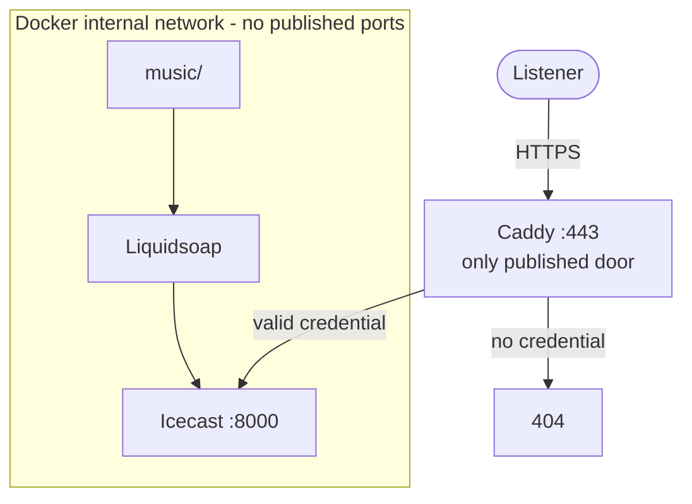
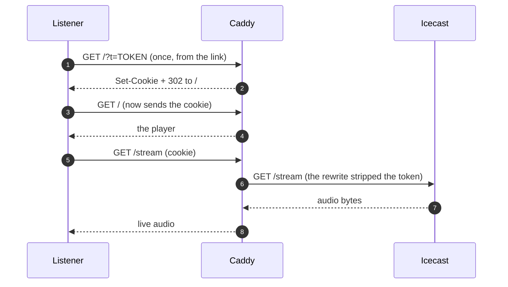

# Private radio with token

A radio that exists for a closed circle. Without a credential, there is no radio.

- **Liquidsoap** plays `./music` in random order.
- **Icecast** serves the stream — and **is not announced in any public
  directory**.
- **Caddy** is the only door: without a valid credential it answers 404, not
  401. It does not confirm to anyone that anything exists here.
- **ffmpeg** turns the USB webcam into HLS, so that in addition to listening
  you can watch. Muted video: the audio is the radio's.

Each person gets **two credentials**:

- a **token**, which travels once in the invitation link and also serves
  players (VLC, mpv, ffmpeg);
- a **cookie**, which the browser receives when opening that link and uses
  from then on. This keeps the token out of the address bar and out of the
  logs on every playback.

All open source, all in a `docker compose up`.

---

## The project

This radio broadcasts from a laptop in the **Sierras de los Comechingones**.
It is not just another radio: everything you hear here is generated by us,
with our own software, no samples and no third-party audio (and therefore
$0 in royalties — see `PLAN-LEGAL-AR.md`).

The music is produced by **indiegenerator**, a deterministic, offline
generator: a seed goes in, a finished, tagged track comes out. The same
`(preset, seed)` produces the same plan and, on the same machine, the same
audio, byte for byte. Re-listening to a track is re-running the same number.
Five lanes (motorik, kosmische, ambient, dub-electronic, indie-noise) share
a single station signature.

The software is built **agenticly, with AI**, on top of the **n3rv**
engineering harness (SDD slices, binary gates, tests that measure structure).
Tracks pass the gates before entering the radio (−16 LUFS, true peak
≤ −1.5 dBTP, MP3 128) and are installed by hand: the radio never restarts
itself.

The stack (Liquidsoap, Icecast, Caddy, ffmpeg, MediaMTX) is the door and
the transport. The content is ours.

---

## Ever growing

This is the tip, not the whole thing. indiegenerator keeps iterating:
new versions, new slices, new techniques, new gates. The lanes you hear
today are the first pass; the generator keeps evolving, changing, improving.

And this radio is the destination for more than one project. Other
generators, other music, other voices, other noises, other sounds — built in
weird ways — will land on this same stream soon. The door does not change;
what comes through it does.

---

## How a track is born

1. A seed (a number) and a lane (motorik, kosmische, ambient,
   dub-electronic, indie-noise).
2. indiegenerator composes the plan: sections, motifs, strategies, mix.
   The plan is hashed (`plan_sha256`).
3. The plan is rendered to audio: single thread, BLAS at 1 thread, streamed
   arrays to stay under 1.5 GB of RAM.
4. Gates: −16 LUFS, true peak ≤ −1.5 dBTP, MP3 128 without surprises, no
   clipping. If it fails, it does not get in.
5. `validate` → `install`: atomic copy into `music/`. The radio never
   restarts; Liquidsoap picks it up on its own.

The same seed produces the same plan and, on the same machine, the same
audio, byte for byte. `render --from-plan` does not compose: it only
re-renders. Determinism is the property, not a side effect.

---

## The five lanes

| Lane | Weight | Tempo | ARTIST | ALBUM |
|---|---|---|---|---|
| motorik | 30 % | 110–140 | Steady Hand | Sixteen Steps |
| kosmische | 25 % | 70–110 | Hollow Signal | Sustained Weather |
| ambient | 20 % | 112–124 | Long Exposure | Rooms in Half Light |
| dub-electronic | 15 % | 100–130 | Silt | Chamber Echoes |
| indie-noise | 10 % | 90–135 | Tin Roof | Loose Ends |

One motif bank, one palette, one 1/f drift, one strategy deck, one
tempo centre. The identity is in the sound, not the tag.

---

## Start

```bash
cd ~/Work/radio

# 1. Configuration (generates random secrets)
cp .env.example .env
sed -i "s|^ICECAST_SOURCE_PASSWORD=.*|ICECAST_SOURCE_PASSWORD=$(openssl rand -hex 24)|" .env
sed -i "s|^ICECAST_RELAY_PASSWORD=.*|ICECAST_RELAY_PASSWORD=$(openssl rand -hex 24)|"   .env
sed -i "s|^ICECAST_ADMIN_PASSWORD=.*|ICECAST_ADMIN_PASSWORD=$(openssl rand -hex 24)|"   .env

# 2. Script permissions
chmod +x scripts/*.sh scripts/*.js

# 3. Generate the matcher and grant yourself access
#    (creates caddy/tokens.caddy, which is NOT versioned because it holds credentials)
./scripts/token.sh add yo

# 4. Bring it up
docker compose up -d --build

# 5. Verify the door closes properly
./scripts/smoke.sh
```

Step 3 prints the link. **That link is the key.** It is opened once in the
browser: the token is exchanged for the cookie, the URL is cleaned, and from
then on the token never travels again.

If instead you start from a clone and want to bring it up before granting
access, copy the template: `cp caddy/tokens.caddy.example caddy/tokens.caddy`
(do not let Docker create the file: it would create a directory).

---

## Grant and revoke access

```bash
./scripts/token.sh add juan     # grants access to juan and prints their link
./scripts/token.sh ls           # who has access
./scripts/token.sh rm juan      # cuts access (token and cookie)
./scripts/token.sh regen        # regenerates the matchers from secrets/tokens.txt
```

**Per-person credentials.** That is the reason for doing it this way instead
of a single shared password: if someone leaks their link, you cut access for
that person and do not change the link for everyone else.

`regen` is useful if you edit `secrets/tokens.txt` by hand, or after bringing
the repo to another machine.

---

## Adding music

Copy the files into `./music/`. They are picked up on their own, no restart
needed.

---

## How the door works

Who can talk to whom. The dotted line of the box is everything NOT published
to the internet:



And the exchange, step by step:



Four layers, each doing something different:

1. **Caddy validates the credential** against `caddy/tokens.caddy` (generated).
2. **The exchange**: the `?t=...` of the link becomes a cookie and the URL is
   cleaned with a 302. From then on the token never travels again.
3. **`rewrite` strips the query** before proxying: the token never reaches
   Icecast, so it cannot appear in its logs.
4. **Icecast publishes no ports.** It lives in Docker's internal network. Even
   if someone finds the container, they cannot reach it from outside.

And the radio **is not announced in directories** (`<directory>` absent in
`icecast.xml` + `<public>0</public>`). It does not appear on dir.xiph.org or
in any radio listing.

---

## The camera

The webcam comes in through the same door as the radio and shows in a small
box below the play button. **Muted video**: the audio is still the radio's.

```
webcam USB (MJPEG 640x480)
   |
   |  ffmpeg: single encode to H.264 600 kbps, 15 fps
   +--> RTSP --> MediaMTX --> WebRTC (WHEP)   <- main path, <1s
   |
   `--> ./data/cam/ (index.m3u8 + seg*.m4s) --> Caddy --> HLS  <- fallback
```

WebRTC is the main path because HLS cannot be "live": it waits for a segment
to close. WebRTC sends frames as soon as they come out.

### Why WebRTC instead of staying on HLS

Measured on this installation, not read in a blog:

| Transport | Delay | How it was measured |
|---|---|---|
| WebRTC (WHEP) | **<1s** | time burned into the frame vs real clock, in a browser capture. The jitter buffer only measured 13-37 ms |
| HLS with hls.js | 1.56s | `hls.latency` stable over 30s |
| Chrome native HLS | ~10s | the same stream, without hls.js |
| Direct MJPEG | ~0.2s | discarded: 47 KB per frame = **5.8 Mbps per listener** |

HLS's floor is the segment: ffmpeg publishes nothing until it closes. That is
why MediaMTX exists: it receives H.264 over RTSP from ffmpeg and redistributes
it over RTP.

**The real trade-off:** signalling (the SDP) goes through Caddy and the gate
like any request, but **the video does not**. It travels over direct UDP from
the browser to MediaMTX, and Caddy never sees it. The port is bound to
`127.0.0.1` in `docker-compose.yml`: today only this machine. For LAN you
publish it on `0.0.0.0` and add the IP to `webrtcAdditionalHosts` in
`mediamtx/mediamtx.yml`. If UDP does not arrive, the page **falls back to
HLS on its own**: you see it with 1.5s instead of failing.

Fallback decisions, which still exist for browsers without WebRTC:

**fMP4 (`.m4s`) and not MPEG-TS (`.ts`).** Verified with curl: Caddy serves
`.ts` as `text/vnd.trolltech.linguist` — extension collision with Qt — and
some browsers reject the segment by MIME. `.m4s` come out as `video/iso.segment`
with no configuration.

**hls.js served from here.** It lives in `web/vendor/` and not on a CDN: if
the page asks a CDN for a script, that CDN sees who enters, when, and from
which IP. See `web/vendor/README.md`. And it is always loaded when MSE is
available, even if the browser claims to play HLS natively: Chrome answers
`"maybe"` to `canPlayType` and its native implementation buffers ~10s with no
knob.

### The HLS fallback budget

| Stage | Cost |
|---|---|
| ffmpeg closes and publishes the segment | 0-1s (`-hls_time 1`) |
| player cushion behind live | 1.5s (`liveSyncDuration: 1.5`) |
| decode the first frame | ~0.3s |

`new Hls()` unconfigured uses 3 **segments** of cushion; with 2s segments that
was 6s. Why 1.5 and not less: at 1.0 the `readyState` dropped to 2 on some
samples (it ran out of buffer at the edge); 1.5 gives a steady 1.56s, not a
single hiccup over 30s.

The pipeline itself (capture -> encode -> publish) adds **50 ms**, measured
with `EXT-X-PROGRAM-DATE-TIME`: the end of the last published segment is 50 ms
behind the clock. Everything else in the delay is the player.

### Changing camera or quality

`CAM_DEVICE` in `.env` points at the FaceCam's `by-id` symlink, which does
not change even if you reconnect the equipment (the `/dev/videoN` number, on
the other hand, depends on the order the kernel enumerates cameras).
Resolution and bitrate are in `cam/capture.sh`: 640x480 at 15 fps, H.264 at
600 kbps.

If the camera is disconnected, the container retries with backoff and the page
**shows no box**: no black rectangles and no error banners. The audio keeps
going as if nothing happened.

`CAM_CLOCK=1` burns the real time into the frame. It is not decoration: it is
what allows measuring glass-to-glass delay (the video's time is compared with
the clock). Off by default.

### The camera in VLC, mpv or ffmpeg

The HLS playlist points to other files, and players request them as relative
paths: if the token is in the query, those requests go out **without** the
token and get 404. That is why the camera, for players, is requested with the
token in the path:

```bash
vlc "http://localhost:8090/cam/<TOKEN>/index.m3u8"
```

Segments inherit the prefix on their own. The browser does not need this: it
uses the cookie, so the token does not appear on every request. `token.sh add`
prints both URLs.

This is the **HLS fallback**, with 1.5s. If you want the stream without delay,
RTSP direct to MediaMTX (port 8554 is not published: from this machine,
`rtsp://localhost:8554/cam`; from outside you have to publish it and decide
whether that breaks the "single door").

---

## How private this really is

Measured, not assumed. What follows is verified on this installation.

**What it does solve**
- Nobody gets in without a credential: without token and without cookie,
  everything returns 404.
- It does not appear in search engines (`noindex`), nor in radio directories.
- Content is encrypted (TLS) when published with a domain.
- You revoke one person without touching anyone else's link.
- **The video is behind the same gate as the audio.** Without a credential,
  `/cam/index.m3u8` and every segment return 404. Verified in the smoke test.
- **Credentials are not written to the logs.** Caddy redacts the cookie on
  its own (`"Cookie":["REDACTED"]`) and the log level is `ERROR`, so the URL
  with `?t=...` is not logged either. Verified: 0 occurrences of both after
  generating traffic.

**What it does NOT solve**
- The token is in the invitation link: if someone shares it or pastes it into
  an unencrypted chat, it leaks. That is the cost of keeping it simple.
- Players (VLC) keep sending the token in the URL. If that matters to you,
  listen from the browser (cookie) and you are done.
- The camera, in players, needs the token in the path
  (`/cam/<token>/...`) and not in the query. That is not a concession: that
  is how HLS works with relative paths.
- It does not hide your IP or your provider. Your VPS knows this exists.
- If you lower the log level to `INFO` for debugging, the players' tokens are
  written. Go back to `ERROR` afterwards.

**Hardening (in cost/benefit order)**

1. **Expiring tokens** — `name token cookie expires`. Revoked by time alone.
2. **One device per credential** — limit on simultaneous connections.
3. **Signed cookie** — the cookie is not the stored value but an HMAC, so a
   dump of `secrets/tokens.txt` is not enough.
4. **Seamless audio** — `crossfade`, jingles, `request.dynamic` to request
   tracks by chat.

Ask for any of these and we add it.

---

## If you want to publish it on the internet

In `.env`, change:

```
SITE_ADDRESS=radio.daza.ar                          # where Caddy serves
PUBLIC_URL=https://radio.daza.ar                    # the URL you give people
COOKIE_FLAGS=HttpOnly; SameSite=Lax; Secure         # here Secure DOES go
```

And uncomment `email {$ACME_EMAIL}` in `caddy/Caddyfile` (there the
`ACME_EMAIL` is actually used for certificate expiry notices).

**Careful with `Secure` on the cookie**: it makes the browser send it only
over HTTPS. Locally (`http://localhost`) it must be off, which is why
`.env.example` does not include it. In production it must be on.

In Cloudflare put the record **grey (DNS only)**, never orange. Cloudflare's
CDN rule restricts content not hosted on Cloudflare, and an audio stream
falls right there.

Caddy gets the certificate on its own.

---

## Validating the diagrams

The diagrams in this README (and in the legal plan) are Mermaid. A syntax
error is not noticed until someone opens the file, so there is a check:

```bash
./scripts/docs.sh
```

It renders every ` ```mermaid ` block of every `.md` and fails if any is
broken, pointing at the line:

```
  OK    PLAN-LEGAL-AR.md       1 diagram(s)
  FAIL  README.md
        Error: Parse error on line 4:
        ...ublicada"]    O -->>|"HTTPS"| C    C -
        ----------------------^
```

Exit codes: `0` all good, `1` broken diagram, `2` missing dependencies.

The first time it installs `mermaid-cli` in `~/.cache/radio-docs`, **not in
the project**: about 450 MB that do not need to live here. It deliberately
uses the system Chrome; otherwise it would also download ~300 MB of Chromium.

If you want to reclaim that space:

```bash
rm -rf ~/.cache/radio-docs
```

---

## Validating the player

`web/index.html` has no build and no test runner, so the structure of its
state machine is checked the same way the diagrams are checked: measured,
not eyeballed.

```bash
./scripts/ui-gate.js
```

It extracts the `<script>` from the page and runs it against a fake DOM and a
fake `fetch`, then counts what reading alone does not show: how many status
fetches happen per tick, how many times `#now` is written, and what the label
does while a reconnection chain is in flight (the chain outranks the tick —
that is the rule, and this is where it is enforced). It also renders both
shapes of `icestats.source` (object and array) and fails if they disagree.

The fake `fetch` can also answer 404, 502 or nothing at all, so the page's
verdict matrix is measured row by row: `200` with source, `200` without,
`404` (the door closed) and a network failure (which must not claim
anything — no "off air", no disabled button while the audio plays). The door's
sentence is asserted verbatim, and it must appear **once** in the source: the
chain and the tick write the same fact, so they cannot be allowed to drift
apart.

```
UI gate — web/index.html

un solo tick de estado:
  OK    al cargar la pagina: exactamente 1 fetch de estado
  OK    15 s: el tick hace exactamente 1 fetch
  OK    15 s: #now se escribe 1 vez

la cadena de reconexion manda sobre el tick:
  OK    tick en vivo: el cartel NO pasa a live

la matriz del tick al cargar (F-03 / F-04):
  OK    404 -> la frase exacta de la puerta
  OK    red caida -> no pinta nada: ni off air, ni puerta, ni boton muerto

Todo bien - 51 chequeos.
```

Exit codes: `0` all good, `1` a check failed. No network, no stack running:
only `node`, the dependency `docs.sh` already had. Every check is binary, so
the gate can fail: against the pre-S1 page 12 checks go red, against the
pre-S2 page 13 do.

### Proving that it can fail

A green gate proves nothing if nobody has ever seen it go red. That is how a
check ended up measuring a phantom element instead of the page — the stub
invented the `btn` id it was asked for, and the row passed for nothing
(issue #23). So the gate carries its own proof:

```bash
./scripts/ui-gate.js --self-test
```

It breaks the page's source **in memory**, one guarantee per mutation, six in
all: a second status tick, the chain guard dropped, the `404` read as any
other response, the transient lie restored, the two endpoint shapes read
differently, the door's sentence written twice. It then demands **red on every
mutation** and **green on the real page**. A mutation that stays green means
the gate stopped measuring that thing — that is a failure, not a pass. A
mutation that no longer applies, because the code changed shape, fails too: a
blind gate is not a lucky one. Nothing is written to disk, so there is nothing
to restore and no chance of committing a mutated page.

```
Self-test — ¿puede fallar este gate?

  OK    pagina real .......................... 51/51 en verde
  OK    un segundo tick de 15 s (la regla de un solo fetch por tick)
          8 rojos, p.e. "un solo intervalo consulta el estado (15000 ms); encontrados: [15000, 15000]"
  OK    la cadena deja de mandar sobre el tick
          3 rojos, p.e. "tick en vivo: el cartel NO pasa a live"

Todo bien - 6 mutaciones atrapadas.
```

Exit codes: `0` six mutations trapped, `1` one went uncaught or did not
apply. Seven runs of the gate, about 0.3 s.

**So neither slips past in a commit:**

```bash
cat > .git/hooks/pre-commit <<'EOF'
#!/bin/sh
if [ -x ./scripts/docs.sh ]; then
  ./scripts/docs.sh || exit 1
fi
if [ -x ./scripts/ui-gate.js ]; then
  ./scripts/ui-gate.js || exit 1
  ./scripts/ui-gate.js --self-test || exit 1
fi
EOF
chmod +x .git/hooks/pre-commit
```

(Careful with `|| exit 0`: if you put it there, the hook *always* passes and
blocks nothing.)

---

## Common problems

**The stream delivers 0 bytes**
```bash
docker compose logs -f liquidsoap
```
Look for `Connecting to icecast:8000`. If it does not appear, the encoder in
`radio.liq` is not available in the image. Try changing `%mp3(...)` to:
```liquidsoap
%ffmpeg(format="mp3", %audio(codec="libmp3lame", bitrate=128))
```

**Icecast does not start**
```bash
docker compose logs icecast
```
Almost always an empty `ICECAST_*_PASSWORD` in `.env`.

**404 even with a valid token**
Caddy did not reload. `./scripts/token.sh add yo` does it on its own; if not:
```bash
docker compose exec caddy caddy reload --config /etc/caddy/Caddyfile
```

**The invitation link leaves the browser on 404 forever**
If your browser still has an old cookie from the time the exchange copied the
token inside the cookie, that cookie never validates again and **is not
overwritten on its own**: the new link replaces it, but you have to open the
link once. Open it. If the 404 persists, then it is the above (Caddy not
reloaded).

**The camera box does not appear**
The page first asks whether the playlist exists; if it does not, it shows
nothing (that is the normal case of "camera unplugged"). To find out which:
```bash
docker compose ps cam                      # is it up?
ls -l data/cam/                            # is there index.m3u8 and seg*.m4s?
curl -s -o /dev/null -w '%{http_code}\n' -H "Cookie: radio=$CK" localhost:8090/cam/index.m3u8
```
If the `cam` container does not start on bring-up, the camera is unplugged:
Docker cannot create the device and fails hard instead of giving you empty
video. The audio starts anyway (the error is in that service, not the stack).
Without a camera, bring up only the rest: `docker compose up -d caddy icecast liquidsoap`.

**`failed to create mountpoint for /srv/...: Read-only file system`**
Docker mounts volumes ordered by path, so `./web:/srv:ro` comes before any
`/srv/...`. Afterwards it cannot create the subdirectory inside a read-only
mount. That is why the camera segments go to `/srv-cam` and the Caddyfile
uses `handle_path`. It happened to us building this.

**The video starts but freezes**
Look for `corrupted data` in the `cam` container logs:
```bash
docker compose logs cam | grep -i corrupto
```
If it appears in short bursts and the video flows, it is UVC driver noise:
measured with `ffprobe -count_frames` and the stream still delivers the 15
fps. If it is continuous and the video stalls, the problem is USB bandwidth:
drop to 320x240 or share the port with another camera you are not using.

**The audio cuts out after a few seconds**
The page reconnects on its own (up to 5 attempts) and distinguishes two
cases: if `/status-json.xsl` also returns 404, it is the credential and
retrying is pointless; if it responds, it is network or server. If the banner
says "replied 404", ask for a new link. If it says "connection dropped",
look at the network. The watchdog watches `currentTime` advance: a network
cut does not always fire `error`, the browser waits for data forever.

**No sound on iPhone**
It is the exception to "MP3 plays everywhere" only if you change the encoder
to Opus or Vorbis. With MP3 128 it should work anywhere.

**The redirect sends `Location: 302` instead of `Location: /`**
Caddy reads the first argument of `redir` as a *matcher*. `redir / 302`
means "match `/`, redirect to `302`". It has to be `redir * / 302`, with
the explicit matcher. It happened to us building this.

**Caddy starts and dies without saying why**
Look first at whether the global block has a stray token. This is a real
error that happened to us building this:

```
unrecognized global option: tu@email.com
```

Cause: `{$ACME_EMAIL:}` alone in the global block. Caddy reads it as the
name of an option. It has to be `email {$ACME_EMAIL}`, and only if the value
is not empty. See `caddy/Caddyfile`.

**`caddy reload` fails with "connection refused" on :2019**
Someone set `admin off`. That turns off the reload API. Leave it active: it
is on localhost *inside* the container and compose does not publish 2019.

**Harmless Icecast warnings**
- `<hostname> not configured, using default value "localhost"` — Icecast
  warns like this when hostname is `localhost`. That is exactly what we want
  (only Caddy reaches it). The warning is from YP, which we do not use.
- `Unsupported or legacy stream type: "audio/mpeg"` — Icecast has no
  specialised handler for MP3 and falls back to the generic one. The audio
  comes out anyway.

**The logs**
Icecast and Caddy write to stdout/stderr on purpose, so `docker compose
logs` shows them. Do not send them to a file: if you redirect them, you go
blind exactly when you need to see the error.

---

## Files

```
radio/
|-- docker-compose.yml        the five services
|-- .env.example              configuration template
|-- icecast/
|   |-- Dockerfile            alpine + icecast (no third-party image)
|   |-- entrypoint.sh         injects secrets from the environment
|   `-- icecast.xml           no <directory>: we do not announce
|-- liquidsoap/
|   `-- radio.liq             the source: playlist -> icecast
|-- cam/
|   |-- Dockerfile            debian + ffmpeg (alpine has no libx264)
|   `-- capture.sh            webcam -> RTSP (WebRTC) + HLS, with retries
|-- caddy/
|   |-- Caddyfile             the door
|   `-- tokens.caddy          GENERATED by token.sh
|-- mediamtx/
|   `-- mediamtx.yml          receives RTSP and publishes WebRTC (WHEP)
|-- web/
|   |-- index.html            the player
|   `-- vendor/               hls.js and its license. Nothing goes to the internet
|-- music/                    your music
|-- data/cam/                 HLS segments. Regenerated on their own
|-- scripts/
|   |-- token.sh              grant / revoke / list access
|   |-- smoke.sh              29 checks in 4 groups
|   |-- docs.sh               validates the Mermaid diagrams
|   `-- ui-gate.js            structure of the player's state machine
`-- secrets/tokens.txt        WHO has access. chmod 600.
                              format: name token cookie [expires]
```

`secrets/`, `.env` and `data/` are in `.gitignore`: they are not committed.

---

## Legal context

See `PLAN-LEGAL-AR.md`. Summary: with free music (CC, INAMU bank, own
production) this is **$0 and in order**. With commercial music, a SADAIC
and CAPIF SGC license applies.